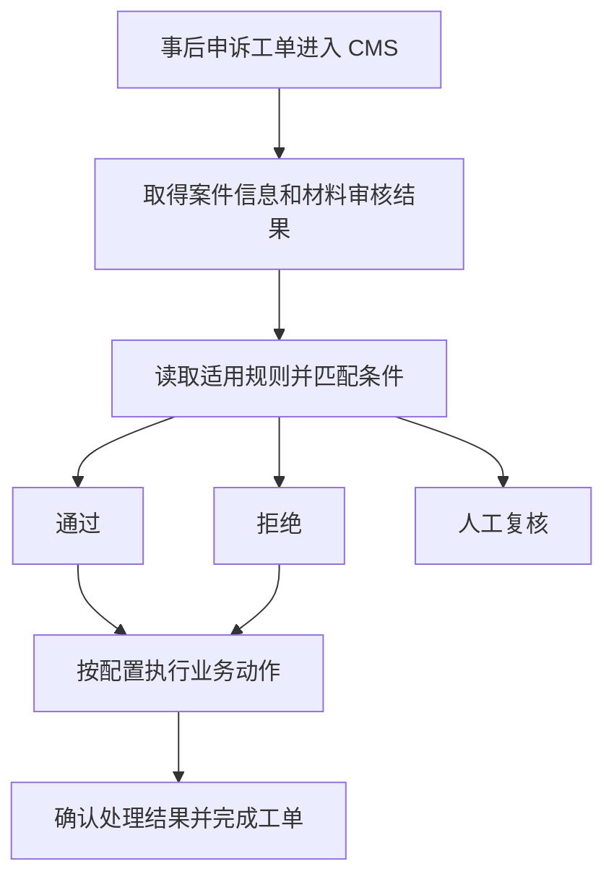

# 风控客诉智能化链路面试准备

## 所有问题

### 业务场景与个人职责

1. 如何在一到两分钟内介绍风控客诉智能化链路？
2. 这条链路在完整风控体系中处于哪个阶段，为什么申诉审核需要单独建设？
3. 原来人工审核怎样工作，哪些情况适合自动审核？
4. 处理的是哪些案件，审核对象和处罚对象分别是什么？
5. 能否用一个具体的业务场景说明系统怎样自动判断？
6. 一个案件从进入运营平台到完成处理，经历哪些步骤？
7. approve、reject 和转人工各自表示什么，哪些情况进入人工审核？
8. 审核结果由谁消费，后续具体执行什么动作，什么时候关单？
9. 简历中的规则审核链路和 Agent 决策链路是什么关系？
10. 哪些部分由你负责，哪些部分由其他团队或已有平台提供？
11. 除了编写配置，你具体进行了哪些代码开发？
12. 面试官认为流程编排比较简单时，怎样说明这个需求的技术难点？

### 规则配置与动作执行

13. TCC、govaluate 和业务执行代码分别承担什么职责？
14. 规则表达式怎样与案件字段绑定并完成求值？
15. 一条规则需要配置哪些内容？
16. 上游标签来自哪里，怎样保证这些数据可以用于判断？
17. 如果规则需要历史统计或时间窗口指标，这些指标怎样获取？
18. 运营提出的文字规则怎样转化为能够执行的配置？
19. 怎样判断业务规则是否合理，研发能够提出哪些建议？
20. 三条业务线之间怎样隔离规则，怎样处理规则重叠？
21. 公共能力怎样复用，业务线增加时怎样降低研发配置工作量？
22. 同时命中多条规则时，怎样决定优先级和最终结果？
23. 字段缺失、类型错误、名单过期或表达式异常时怎样处理？
24. actions 怎样映射到代码中的能力，为什么需要注册和参数校验？
25. 哪些动作能够并行，哪些动作必须按顺序执行？
26. 新增规则、新增标签和新增动作分别需要哪些改动？
27. 规则怎样热更新，怎样确认更新已经生效？
28. 怎样阻止错误配置影响线上案件？
29. 多区域配置和处理中的案件怎样使用一致的规则版本？
30. 某条规则造成集中误报时，怎样快速停止自动处理？

### Agent 接入与判断质量

31. 为什么采用规则与 Agent 配合的方式，双方分别处理什么问题？
32. 三个 Agent 分别做什么，怎样协作？
33. 给 Agent 提供哪些材料，KYC 信息有什么作用？
34. OCR、材料真实性判断和 Agent 编排之间有什么关系？
35. Agent 返回什么内容，业务服务怎样使用这个结果？
36. Agent 超时、无法判断和明确拒绝，怎样在业务上区分？
37. 怎样保证 Agent 结果对应当前案件、当前材料和当前申请人？
38. 使用了什么模型，你参与了哪些模型相关工作？
39. 简历中的 92% 究竟衡量什么，怎样回答关于统计口径的追问？
40. accuracy、precision、recall 和错误放行率分别怎样计算？
41. 人工标注怎样作为评估依据，怎样防止评估数据产生误导？
42. 错误放行和错误拒绝分别有什么代价，怎样确定自动审核范围？
43. Agent 质量下降时，怎样发现问题并形成改进流程？

### 异步通知与业务一致性

44. 为什么改为异步执行，RPC、Agent 结果和 MQ 通知怎样衔接？
45. Agent 完成后通知消费失败，怎样保证案件继续处理？
46. 通知没有发出、已经确认但业务未完成时，怎样发现遗漏案件？
47. 异步请求已经结束后，怎样检测五秒超时，context 能负责哪些事情？
48. 超时处理与 Agent 回调同时发生，或者回调迟到时怎样处理？
49. RPC 超时以后是否能够直接重试，怎样处理结果未知？
50. 同一个案件重复进入时怎样保证幂等，版本号发挥什么作用？
51. 一个案件包含多个动作时，怎样保证每个外部动作的幂等？
52. 机审与人工审核同时处理同一个案件时怎样协调？
53. 服务重启后，怎样恢复执行进度？
54. 一部分动作成功、一部分动作失败时怎样处理？
55. 怎样区分审核完成、业务执行完成和工单关闭？
56. 同一个商家或同一张卡同时存在多个案件时怎样处理冲突？
57. 跨区域用户的风险记录和处置动作怎样保持正确？
58. 分布式锁能够解决哪些问题，状态条件更新还需要做什么？
59. 处罚记录、名单或缓存数据不及时，会怎样影响审核判断？
60. 怎样保存审计记录，让一条审核结果能够被解释和追查？
61. 银行卡照片、身份信息及模型输入输出怎样保护？

### 性能指标与业务效果

62. 一个案件处理时间从一秒增加到二十秒，怎样定位原因？
63. RPC 超时、整体处理时限和重试次数怎样确定？
64. 并行查询和提高处理能力时，怎样保护下游服务？
65. 这条链路的 QPS、机器数量和服务容量应该怎样说明？
66. 哪些数据适合缓存，怎样识别热点并保证数据时效？
67. 如果重新设计监控打点，会记录哪些指标？
68. 自动审核漏斗怎样建立，分母、分子和去重方法怎样定义？
69. 28%、20% 多、9% 和 80% 之间应该怎样解释？
70. 父子单复用 115 次和有效规则命中约 36 次分别表示什么？
71. 父子单结果在什么条件下能够复用，怎样防止错误复用？
72. 怎样衡量 AHT、等待时间和节省的人工工作量？
73. 怎样计算模型成本和 ROI，怎样回答实际成本未知的问题？
74. 怎样验证整条自动审核链路的正确率？
75. 自动处理比例只有百分之十几时，技术上还能做什么？
76. 怎样验证新规则或新模型优于已有方案？

### 测试上线与协作

77. 测试环境的卡照和身份材料怎样准备，约七千份材料该怎样说明？
78. 这条链路应该覆盖哪些业务、并发和故障测试？
79. 怎样发布规则和代码，怎样控制不同地区的启用范围？
80. Agent 故障后大量案件进入人工审核，会出现什么问题？
81. 动作配置和能力编排的设计价值怎样说明，怎样提供证据？
82. 规则和接口持续变化时，怎样与运营、产品和算法团队合作？
83. 技术方案由谁决定，你怎样使用导师建议和 AI 辅助开发？
84. 再次负责这个需求时，会重点完善哪些环节？
85. 如何用英文介绍这个项目和个人贡献？

## 逐题回答

### 1. 如何在一到两分钟内介绍风控客诉智能化链路？

**来源：录音问题。** S01 09:02，S05 04:22，S10 01:39，S12 02:49。

**面试回答：**

我在字节跳动 Global Payment 的风控安全平台做后端开发，参与最多的是运营平台上的风控客诉智能化审核链路。它处理支付风险处置之后，用户或商家提交的申诉案件。原来这些案件需要人工在 CMS 平台查看材料、核对风险记录，再执行对应的业务动作。这个需求希望把能够明确判断的一部分案件交给系统处理，减少重复审核工作。

我负责运营平台中的后端链路建设，包括读取规则配置、整理案件字段、匹配规则、接入上游 Agent 结果，以及按配置调用下游能力。规则通过内部 TCC 平台管理，表达式通过 govaluate 求值；算法团队提供的 Agent 负责材料相关判断，它的结果作为规则的一项输入。系统根据完整条件决定通过、拒绝或转人工，并执行对应动作。

我重点考虑了业务线之间的规则范围、动作的执行顺序、异常情况下的案件处理，以及上线后的命中与完成情况。效果数字需要同时说明观察时间、地区和统计范围。我能直接说明自己的后端工作，以及当时观察到的处理效果。

### 2. 这条链路在完整风控体系中处于哪个阶段，为什么申诉审核需要单独建设？

**来源：录音问题。** S02 03:25—04:24，S06 05:58—06:31，S07 07:17—10:04。

**面试回答：**

这条链路处理事后申诉。支付过程中，策略系统已经根据当时的交易信息识别风险，验证和处罚系统完成了相应处理。用户随后补交卡照、身份材料或其他凭证，提出复核申请，案件进入运营平台。

申诉阶段增加了新的证据，也增加了人工复核和工单处理要求。系统需要重新核对申请人、材料和历史风险记录，判断已有处置是否需要调整，再执行业务动作。这些材料在最初交易发生时可能尚未提交，因此申诉审核有独立的输入和处理流程。

策略、验证、处罚和运营平台各自承担一部分职责。我参与的是运营平台的事后审核能力建设。录音能够确认这些模块之间的业务关系，内部完整风控架构以及策略算法需要以对应团队资料为准。

### 3. 原来人工审核怎样工作，哪些情况适合自动审核？

**来源：录音问题。** S02 09:57，S05 07:34，S06 12:50，S07 08:23。

**面试回答：**

原来由审核人员在 CMS 上查看工单，核对用户提交的材料和业务信息，再按运营规则给出结论、调用后续处理能力。运营会整理人工处理中的重复场景，由产品和研发协商形成能够执行的规则。

适合自动化的场景需要满足几个条件：案件类型明确，关键字段和材料完整，判断依据能够获取，处理方式得到业务确认，异常情况有明确的人工处理路径。涉及材料矛盾、信息缺失、多个规则冲突或无法确认结果的案件，需要继续人工复核。

自动化覆盖范围需要结合判断质量决定。能够匹配表达式，只能说明技术条件满足；是否适合自动放行或拒绝，还需要用历史案件和人工复核结果验证。

### 4. 处理的是哪些案件，审核对象和处罚对象分别是什么？

**来源：录音问题。** S07 07:40—08:13，S11 09:41—10:24，S02 04:24。

**面试回答：**

处理对象是支付风控处置后提交的客诉或申诉工单，涉及直播、电商和广告业务。一个工单需要关联申请人、业务线、案件类型，以及此前的风险和处置记录。

案件和处置对象需要分别说明。案件是一次申诉申请；风险处置的对象可能是商家、用户、支付工具或其他业务主体，具体取决于原来的策略。审核通过以后，需要确认本次申请涉及哪一项处置，以及允许执行什么动作。

录音中的具体案件类型名称存在语音识别差异，能够确认的是支付风险相关的事后申诉场景。面试中可以说明这层业务范围，内部 case category 常量和每种类别的精确定义需要查阅原始需求或接口文档。

### 5. 能否用一个具体的业务场景说明系统怎样自动判断？

**来源：录音问题。** S04 16:58—20:40，S06 07:47，S08 09:16。

**面试回答：**

可以用支付受限后的申诉说明：商家认为自己的支付工具被误拦截，向平台提交银行卡照片和身份材料，希望复核。系统接收案件后，取得它所属的业务线、案件类别、名单情况和相关历史信息，并取得上游材料审核结果。

如果这些信息完整，且满足业务确认过的一条通过规则，就给出通过结论，并按该规则执行指定的处置或回复动作。发现明确不满足通过条件、且符合拒绝规则时，执行对应的拒绝处理；材料不足、结果未知或没有适用规则时，继续人工审核。

**按对话推断：** 这个例子根据录音中的支付受限、卡照、KYC 和名单判断整理，表达业务流程。真实通过条件、阈值和动作组合需要以内部规则为准。涉及恢复支付资格或解除具体处罚时，应当明确对应的业务授权和下游接口能力。

### 6. 一个案件从进入运营平台到完成处理，经历哪些步骤？

**来源：录音问题。** S02 09:04—12:08，S03 02:35—07:55，S05 08:04—09:15。

**面试回答：**

可以按输入、判断和执行三个环节说明。输入环节取得工单和相关业务数据，确认案件类型、业务线以及需要的材料结果。判断环节读取适用规则，把字段提供给表达式求值，形成通过、拒绝或转人工的结果。执行环节按配置顺序调用注册好的能力，处理用户回复、名单操作或其他业务动作，再完成工单处理。

每个环节都要区分业务结果和技术异常。规则正常求值但不满足条件，与查询失败、材料未返回和动作执行失败，分别对应不同的处理原因。后续排查需要能够知道案件停在哪个步骤。

**按对话推断的业务关系示意：**

图中展示业务关系；异步通知、超时检测和状态竞争的设计见第 44—55 题。

### 7. approve、reject 和转人工各自表示什么，哪些情况进入人工审核？

**来源：录音问题。** S03 05:12—05:36，S07 11:36—12:32，S11 14:01—14:18。

**面试回答：**

approve 表示本次申诉满足业务规定的通过条件；reject 表示满足拒绝条件；转人工表示当前信息或自动规则无法给出足够可靠的终局判断。reject 在录音中还提到业务上的进一步分类，内部枚举和对应权益需要查阅需求定义。

进入人工审核的情况包括没有适用规则、必要材料缺失、名单或历史信息不可用、Agent 未及时返回、多个判断相互矛盾，以及自动处理无法正常继续。技术异常需要保留具体原因，人工人员才能知道需要补充什么信息或检查什么步骤。

approve 或 reject 是审核结论；案件是否真正处理完成，还取决于对应业务动作是否执行成功。明确这两个阶段，能够回答后续关单和失败重试的问题。

### 8. 审核结果由谁消费，后续具体执行什么动作，什么时候关单？

**来源：录音问题。** S03 05:36—06:44，S02 10:05，S08 12:34，S14 36:45。

**面试回答：**

审核结论由后续业务执行链路使用。配置中描述需要执行的动作，代码把动作名称映射到已经接入的服务能力，例如打标、名单操作、自动回复和关单。不同结论、案件类型和业务线可以对应不同的动作组合。

如果某种案件涉及支付限制解除，需要由具备相应业务权限的下游能力处理，具体处置范围以该业务的规则与接口定义为准。面试时需要选取自己确认过的一个动作，说明输入参数、调用对象、返回结果和失败处理。

**实现建议：** 将“审核已给出结论”和“必要动作已执行完成”分别记录，必要动作都成功以后才能关闭对应工单。存在结果未知或部分动作失败时，保留案件并进入重试或人工处置流程。录音没有完整给出这部分关单状态定义。

### 9. 简历中的规则审核链路和 Agent 决策链路是什么关系？

**来源：录音问题。** S03 11:22，S06 11:16，S07 19:34—20:53。

**面试回答：**

它们围绕同一条业务链路。规则审核部分建设运营平台的自动判断和动作执行能力；Agent 接入部分增加材料审核结果这一项输入，让规则能够参考银行卡材料的真实性和一致性判断。

我负责把上游结果接入业务服务，确认案件关联、结果语义和异常处理，再让它参与规则匹配。Agent 内部的模型选择、OCR 和各个子 Agent 的实现，由算法团队负责。

可以按“规则及动作编排”和“材料审核能力接入”说明两项产出的不同工作内容，也要说明两者共享业务目标、案件数据和最终执行流程。这样，面试官能够理解每项工作的范围。

### 10. 哪些部分由你负责，哪些部分由其他团队或已有平台提供？

**来源：录音问题。** S01 10:40—12:39，S02 18:06，S03 12:02，S07 05:03、20:48，S11 19:09。

**面试回答：**

我负责运营平台中本次新增审核链路的后端开发，包括配置内容的业务接入、案件字段整理、规则匹配、动作与能力的映射，以及上游 Agent 结果的接入和下游调用。业务规则来自运营处理经验，并由产品、运营和研发共同确认。

TCC 配置平台和表达式库是已有能力；算法团队提供材料审核 Agent；验证、处罚、名单以及其他业务系统提供相应的数据或处置接口。我需要理解它们的输入输出和执行限制，完成本次链路中的组合与调用。

“端到端”可以说明我参与的范围从运营案件输入持续到业务执行。原有支付体系、配置平台和所有下游能力的完整实现范围，分别属于对应团队。

### 11. 除了编写配置，你具体进行了哪些代码开发？

**来源：录音问题。** S02 11:56—12:08，S05 08:16—09:15，S11 12:17—12:41。

**面试回答：**

配置描述判断条件和执行顺序，业务代码负责把这些描述变成实际处理。我做的工作包括把配置接入服务中的数据结构，整理案件的规则参数，调用表达式库完成条件判断，再根据判断结果取得动作列表，映射到具体能力并组织执行。

每个能力还需要完成接口参数转换、案件信息关联、调用结果处理，以及对应的日志和监控。Agent 结果也需要通过业务服务接入，成为规则的一项输入。这些工作共同构成该场景的执行链路。

面试官继续要求函数或字段时，需要结合自己保存的代码、接口定义或设计文档说明真实模块名称。当前录音支持上述工作范围，具体 handler 名称、注册结构和内部字段名称需要核对原始材料。

### 12. 面试官认为流程编排比较简单时，怎样说明这个需求的技术难点？

**来源：录音问题。** S01 12:39—13:41，S04 21:09，S10 03:02，S11 12:47。

**面试回答：**

这个需求的技术工作集中在多个服务组合后的业务正确性。不同业务线有不同规则和动作，规则需要持续调整；输入数据和 Agent 结果有时序要求；自动动作可能产生业务影响；执行过程中还会出现重复请求、超时和人工同时操作的情况。

我能直接说明的设计，是把判断条件和动作顺序配置化，把动作名称与已接入的能力建立映射，并按业务要求执行，让后续规则调整能够复用已有能力。相关异常和线上效果，需要通过案件状态与监控定位。

为了说明技术价值，我会选一个完整案件，给出输入来自哪些接口、命中哪类规则、执行哪些动作，以及某一步失败后案件怎样继续处理。涉及幂等、异步通知或状态控制时，也会明确自己完成了哪些部分、复用了哪些框架能力。

### 13. TCC、govaluate 和业务执行代码分别承担什么职责？

**来源：录音问题。** S05 06:19、08:04，S03 06:44—08:17，S11 11:49—12:41。

**面试回答：**

这里的 TCC 是内部配置平台，用来管理和分发规则内容。业务服务取得配置之后，把内容读取到约定的数据结构中。govaluate 对表达式求值，判断当前案件的字段是否满足某个条件。

业务执行代码负责选择适用规则、组织求值参数、处理结果，以及按动作配置调用下游能力。配置平台负责分发内容，表达式库负责计算条件，业务代码负责本次案件的完整处理。

录音提到过 Conan 服务链路，但具体服务后缀和内部 SDK 名称存在语音识别差异。说明其职责时可以使用“运营平台中的业务服务”，准确服务名称需要核对代码或设计文档。

### 14. 规则表达式怎样与案件字段绑定并完成求值？

**来源：录音问题。** S05 08:16，S08 10:52，S15 06:54。

**面试回答：**

规则表达式描述条件，例如案件类别和业务线是否符合要求、某个名单条件是否满足。服务取得当前案件的数据以后，按照约定的字段名称组织参数，把参数提供给表达式对象求值，并确认结果能够作为布尔条件使用。

govaluate 提供 `NewEvaluableExpression` 和 `Evaluate`。表达式可以解析后重复用于不同参数；配置变更时预先解析表达式，有助于减少请求中的重复解析工作。这个用法可以查阅 [govaluate README](https://raw.githubusercontent.com/Knetic/govaluate/master/README.md)。

**实现建议：** 在启用配置时校验表达式语法、变量范围和参数类型；求值时明确报告缺失字段和类型错误。与名单查询或其他 RPC 有关的数据准备，应当有清晰的业务步骤和监控。录音能够确认表达式匹配过程，是否已经预先解析并复用对象需要查阅代码。

### 15. 一条规则需要配置哪些内容？

**来源：录音问题。** S02 10:05—10:46，S03 06:44—07:37，S06 07:57，S08 15:58。

**面试回答：**

录音中能够确认的内容包括规则名称或标识、判断表达式、对应的审核结果，以及后续动作列表。某些规则还需要名单信息、作用对象和有效时间等参数。业务线、案件类别和 Agent 结果等条件，可以参与表达式判断。

从执行角度，一条规则至少要回答“适用于哪些案件”“什么条件满足以后命中”“命中后得到什么结论”“执行哪些动作”。这些内容相互关联，修改时需要一起验证。

**实现建议：** 增加明确的配置版本、启用范围和修改记录，用于发布检查和结果追查。当前材料没有给出完整配置 Schema，因此这些字段作为设计讨论说明，具体内部 identifier 保留代码中的原名。

### 16. 上游标签来自哪里，怎样保证这些数据可以用于判断？

**来源：录音问题。** S04 19:17—20:14，S08 10:38—10:52，S02 07:30。

**面试回答：**

业务线、案件类别等信息来自工单和接入数据；名单、申诉历史和处罚记录需要依赖对应系统；材料判断来自上游 Agent。服务把这些来源的结果组织为当前案件能够使用的输入。

一个字段需要明确来源、含义和更新时间。例如“曾经被处罚”和“当前仍处于处罚中”分别表示不同条件；未取得名单数据与确认不在名单中，也对应不同情况。来源调用失败时，需要把失败状态传递到判断环节。

**实现建议：** 给重要特征保留查询时间或业务版本，并校验申请人与材料的关联。对会影响放行或处罚的状态，在执行动作前按照业务要求确认当前值。录音没有完整的数据来源表，面试中可从自己确认过的字段开始说明。

### 17. 如果规则需要历史统计或时间窗口指标，这些指标怎样获取？

**来源：录音问题。** S06 09:24—10:34。面试官明确追问统计类指标和实时计算。

**面试回答：**

如果是已经存在的历史计数或时间窗口特征，我会调用提供该指标的服务，确认它的主体、时间窗口、更新时间和数据完整性，再把结果作为规则输入。单次工单字段可以直接取得；“最近一段时间内的次数或比例”需要先完成统计。

如果当前没有该能力，需要结合数据来源和时效要求建设聚合服务。事件可以通过消息流进入统计过程，按商家或用户聚合；同时明确迟到事件、重复事件、时区和窗口边界的处理。简单低频场景也可以从数据库计算，方式取决于查询量和延迟要求。

**事实范围：** 录音没有给出统计服务的具体实现。需要确认指标来源、刷新频率以及个人参与的接入工作，面试回答围绕如何获取和正确使用统计特征展开。

### 18. 运营提出的文字规则怎样转化为能够执行的配置？

**来源：录音问题。** S02 11:14，S06 10:34—11:06，S10 04:45。

**面试回答：**

运营从人工审核经验中整理场景，产品协助明确规则，研发确认字段来源、判断条件和可调用的能力。讨论时需要把自然语言描述转换为明确条件，例如适用业务线、案件类型、名单要求、材料状态以及对应处理结果。

我会给每个条件准备满足、未满足和信息未知的案例，与运营确认预期结果。再把条件编写成表达式，把后续处理写成动作配置，并核对动作顺序、参数和失败时的案件处理。

录音表明当时由研发参与配置编写，运营提供业务建议。面试中可以明确这一工作方式。表达式支持动态调整，业务判断的审批和发布责任也需要明确。

### 19. 怎样判断业务规则是否合理，研发能够提出哪些建议？

**来源：录音问题。** S07 12:32，S10 05:13—07:31。

**面试回答：**

我会从数据、流程和业务后果三个方面判断。数据方面，规则使用的字段是否能够取得、是否足够及时、未知值怎样处理。流程方面，规则是否与其他条件冲突，动作能否按规定顺序完成。业务后果方面，通过或拒绝会改变哪些权益，是否需要人工复核以及怎样评价错误判断。

运营提供审核经验，研发负责让规则在系统中按照约定运行，也需要参与判断异常和并发场景。录音中提到过一个具体讨论：案件正在机审时，运营人员是否还能同时处理。它涉及状态显示、处理权和动作冲突。

**实现建议：** 用经过复核的历史案件评价规则，并记录错误类型与影响。只统计规则命中数量，无法说明业务判断质量；是否已经建立完整评估流程，需要以实际材料为准。

### 20. 三条业务线之间怎样隔离规则，怎样处理规则重叠？

**来源：录音问题。** S03 08:26—09:30，S08 12:08，S10 03:02。

**面试回答：**

录音中的做法是由上游提供业务线标记，在规则中明确直播、电商或广告的适用条件。不同业务线分别维护自己的规则，执行时使用当前案件的业务线信息进行匹配。

对于规则重叠，需要明确规则的适用范围、优先级，以及同时满足条件时的业务结果。相同业务线中也可能存在不同案件类别或不同地区的规则，不能只依赖业务线一个维度判断。

**实现建议：** 发布前用历史案件检查多条规则的共同命中情况。出现相互矛盾的自动结论时，应当进入明确的冲突处理流程。录音说明讨论过优先级，具体采用排序、首条命中或其他方法，需要核对代码。

### 21. 公共能力怎样复用，业务线增加时怎样降低研发配置工作量？

**来源：录音问题。** S03 09:11—10:05。

**面试回答：**

当时业务规则按业务线分别配置，底层的名单查询、材料结果读取和业务动作可以通过已接入的能力复用。规则描述本条业务怎样判断，能力实现完成对应查询或操作。

如果需要支持更多业务线，我会把常用条件和动作做成有明确参数说明的模板，提供配置检查、历史案件验证、审批和发布能力。运营可以在授权范围内组合已有能力，研发维护字段及动作的实现。

**设计讨论：** 新业务能够复用已存在的字段和动作时，调整配置即可覆盖；新字段或新业务动作仍然需要开发接口接入、校验和测试。录音没有确认已建设运营自助配置页面，应当将其作为完善方案说明。

### 22. 同时命中多条规则时，怎样决定优先级和最终结果？

**来源：录音提及的设计问题及延伸追问。** S08 12:08，S17 51:59—53:30。

**面试回答：**

需要由业务明确规则的作用范围和冲突处理方式。可以根据业务线、案件类型和地区取得候选规则，再按照经过确认的优先级进行判断。某些限制条件需要在任何自动通过之前检查；相互矛盾的结果应当有明确处理路径。

如果采用“按优先级选择第一条满足的规则”，配置中就需要有稳定的优先级，日志中记录候选规则与最终命中规则。如果采用多个条件共同决定结果，也需要明确组合方式和冲突处理。具体选择取决于业务定义。

**事实范围：** 录音没有确认当前代码的精确算法。能够确认的是，业务之间的条件重叠和优先级曾经需要协商。面试中说明设计原则，再根据代码回答实际机制。

### 23. 字段缺失、类型错误、名单过期或表达式异常时怎样处理？

**来源：录音问题及延伸追问。** S11 14:01—14:18，S08 15:58。

**面试回答：**

这些情况需要分别记录。必要字段缺失，说明当前证据不足；字段类型错误，说明输入或接口使用出现问题；名单过期，需要根据名单业务定义判断有效性；表达式异常，说明规则无法正常执行。

对于依赖这些信息的自动结论，系统应当停止该自动判断并把案件交给明确的人工处理流程，同时保留原因。表达式和参数校验应当尽量在启用配置时完成；请求阶段发现问题，需要明确报告错误，后续业务状态由案件处理流程决定。

**实现建议：** 定义可查询的失败原因，分别统计字段缺失、查询失败和表达式错误。语法无效的配置无法启用，未知的业务数据不能被当作已经确认的事实。

### 24. actions 怎样映射到代码中的能力，为什么需要注册和参数校验？

**来源：录音问题。** S11 17:27—18:20，S08 12:34，S15 05:30。

**面试回答：**

配置中的动作名称对应代码中已经接入的能力。业务服务取得动作列表以后，通过约定的映射找到对应实现，将当前案件和配置参数组织成接口请求，再按业务要求执行。

录音提到的是动作常量与方法的映射。它的价值是让规则组合能够复用已有能力，并明确动作执行顺序。增加一个新的动作实现，需要把对应服务的参数、返回结果和异常处理接入注册范围。

**实现建议：** 配置只能引用经过注册的动作，启用时检查名称、参数、业务权限和作用对象。某个动作不存在或参数不符合要求时，应当直接报告配置错误。实际注册结构和函数名称需要保留代码中的原名。

### 25. 哪些动作能够并行，哪些动作必须按顺序执行？

**来源：录音问题。** S02 20:08—20:35，S11 13:02。

**面试回答：**

我会根据数据依赖和业务操作顺序判断。两个查询互相不需要对方结果，也不会修改同一个业务对象，可以考虑并行。某个动作需要前一步产生的业务标识，或者必须确认前一步成功以后才允许执行，就需要保持顺序。关单通常依赖必要业务动作已经完成。

录音中我明确说明过，这条链路当时配置的后续动作按顺序执行。并行处理是面试官进一步提出的优化问题。如果考虑优化，我会画出依赖关系，找出能够独立进行的信息查询，再结合下游处理能力限制并发数量。

即使两个动作的输入独立，也要检查它们是否修改同一个商家、银行卡或名单。独立读取和独立修改需要分别判断；业务允许的顺序需要与产品和下游能力提供方共同确认。

### 26. 新增规则、新增标签和新增动作分别需要哪些改动？

**来源：录音问题。** S04 22:23—24:36，S03 09:37。

**面试回答：**

如果新规则使用的字段和动作都已接入，就可以在配置中增加条件、结果和动作组合，完成校验与发布。新增标签需要确认上游接口是否已经提供、字段含义和类型是什么，必要时增加数据读取和参数映射。

新增动作需要接入对应接口，明确参数、业务授权、超时与返回结果，再加入能力注册范围。已经注册的动作可以继续组合使用；全新的业务能力需要代码开发和测试。

这样的设计将常见规则调整与能力扩展分别处理。动态配置支持的是已有能力范围内的组合变化。面试中可以选一个真实修改说明改了哪些配置、哪些代码，以及怎样验证结果。

### 27. 规则怎样热更新，怎样确认更新已经生效？

**来源：录音问题。** S08 15:18—15:49，S13 29:53—32:43。

**面试回答：**

当时规则通过 TCC 管理，录音中确认过可以修改配置后改变案件处理分支，无需为每次规则调整重启业务服务。业务服务使用配置平台提供的接入能力取得新的内容。

**实现建议：** 更新内容需要经过语法和业务校验，再一次性发布为新的配置对象。实例记录正在使用的版本、读取时间和启用状态，通过监控确认指定地区的实例已经取得目标版本。修改成功、实例已经加载、案件实际使用了新规则，分别对应三个检查位置。

具体 SDK 使用监听推送、长轮询或其他方式，需要查看平台文档。可以解释这些机制的原理，当前材料支持的事实是内部平台提供动态配置能力。

### 28. 怎样阻止错误配置影响线上案件？

**来源：延伸追问。** 根据 S08 15:18 和 S13 29:53 的规则动态生效问题准备。

**面试回答：**

如果由我完善发布流程，我会在配置启用前检查格式、字段类型、表达式语法、动作是否注册、动作参数是否有效，以及业务线和地区范围是否正确。对于互相矛盾的规则，还需要用历史案件检查冲突。

候选配置要经过业务确认和研发检查，通过验证后才发布。运行中的服务可以保留当前有效版本，未通过校验的新内容无法成为活动配置，同时将发布失败明确通知负责人。如果已经没有适用的有效配置，相关案件应当进入人工流程。

这样能够让错误在配置发布环节被明确发现。录音没有完整说明这些校验和审批功能已经实现，面试中应当将它们作为具体完善方案讨论。

### 29. 多区域配置和处理中的案件怎样使用一致的规则版本？

**来源：录音问题及延伸追问。** S09 第 7 题，S13 32:05—33:09，S17 51:59。

**面试回答：**

需要分别确认配置分发、地区适用范围和单个案件处理使用的版本。各地区可以有独立业务规则；同一版本在多个实例中的加载进度，也可能存在时间差。跨地区发布需要检查哪些地区启用、各自加载了什么版本。

**实现建议：** 在案件开始判断时取得适用配置的版本，并记录本次输入和决策。已经得出结论的案件继续执行对应的已确认动作；需要使用新规则重新审核时，创建明确的新审核次数，重新校验案件状态和业务限制。

单次规则调整不能只观察配置平台显示成功。还要检查实例加载状态以及实际案件日志中的版本。TCC 的底层多区域复制方式和跨地区同步时限，录音没有提供可确认的技术细节。

### 30. 某条规则造成集中误报时，怎样快速停止自动处理？

**来源：录音问题。** S08 15:18—15:58。

**面试回答：**

当时的配置机制支持调整表达式或结果分支，使相关案件进入人工审核。定位到具体规则、业务线和地区以后，可以停止该规则在对应范围内的自动决策，检查配置是否已经在业务实例生效。

**实现建议：** 对已经取得处理结论、但尚未执行业务动作的案件，再检查规则是否被紧急停用。对于已经执行的动作，保存受影响案件清单，由业务方确认补救方式。紧急停用状态需要在实际动作入口校验，覆盖已经开始处理的案件。

同时观察自动通过、自动拒绝、人工介入和未完成案件数量。系统出现异常时，可以暂停受影响的自动动作，保留工单和审核记录，并确保人工队列能够继续承接。

### 31. 为什么采用规则与 Agent 配合的方式，双方分别处理什么问题？

**来源：录音问题。** S05 05:36—06:05，S17 54:14—01:02:42。

**面试回答：**

业务线、案件类别、名单有效性等明确条件适合由规则判断。银行卡照片和证明材料涉及文字提取、真实性线索以及与身份信息的关联，算法团队提供的 Agent 承担这部分判断，输出业务服务能够使用的结果。

运营平台取得材料结果以后，结合其他条件确定是否能够自动通过、拒绝或转人工。规则保持明确的业务限制，Agent 为材料处理提供一项能力。是否执行具体业务动作，仍然需要满足完整业务条件。

这种分工也便于分别评价材料能力、规则判断和动作执行。我的工作集中在 Agent 结果接入和后续业务处理；Agent 内部的提示词、模型训练和完整编排结构，需要由算法团队资料确认。

### 32. 三个 Agent 分别做什么，怎样协作？

**来源：录音问题。** S12 10:35—12:03，S09 第 5 题，S07 20:17。

**面试回答：**

按照录音中明确列出的角色，有材料信息提取 Agent、真伪识别 Agent 和一致性比对 Agent。信息提取负责从卡照或凭证中取得可用内容；真伪识别关注材料是否存在伪造线索；一致性比对关注材料与用户、支付或历史身份信息是否能够相互印证。

录音描述了顺序处理：前面的信息处理为后续判断提供输入，最后形成一个综合结果返回业务链路。我接入的是对外提供的审核能力，使用综合结果参与规则判断。

**按对话推断：** 上述职责说明依据角色名称和录音中的材料用途整理。每个 Agent 的精确输入输出、是否全部必须通过、是否有置信度阈值和提前终止规则，当前材料没有完整说明，需要核对算法接口与设计文档。

### 33. 给 Agent 提供哪些材料，KYC 信息有什么作用？

**来源：录音问题。** S07 20:57—21:48，S09 第 6、8 题。

**面试回答：**

录音提到卡照、身份信息、电话、支付账单及 KYC 信息。材料审核需要核对申请人和相关支付主体的关联，并判断上传材料是否支持本次申诉。不同案件所需材料应当由接口和业务规则定义。

KYC 信息能够提供已经收集的身份资料，供材料与申请人关系核对。例如材料提取出的持有人信息，需要与授权取得的身份信息进行比对；信息存在矛盾时，继续人工复核。

传递材料时需要确认采集授权、接口权限和必要字段范围。具体使用了哪些 KYC 字段、数据从哪个服务取得，以及每种材料的必填要求，需要查阅原始接口定义；面试中可以明确录音能够支持的材料类别。

### 34. OCR、材料真实性判断和 Agent 编排之间有什么关系？

**来源：录音问题。** S01 12:25，S08 09:56。

**面试回答：**

OCR 负责把图片中的文字转换为能够处理的信息，例如卡照上的文本。材料真实性判断还要结合图像线索和其他业务证据；一致性判断需要核对提取内容与申请人或历史资料的关系。

Agent 编排组织这些步骤的输入、调用和结果。录音提到上游使用 OCR，以及三个不同职责的 Agent，说明材料能力由多个判断环节组成。我负责接入其对外结果，并在业务规则中使用。

只从接口结果无法确认内部是否存在动态工具选择、循环推理或某种具体 Agent 框架。面试官问到这些机制时，可以说明自己了解的处理职责和接口，进一步的内部实现需要算法团队资料支持。

### 35. Agent 返回什么内容，业务服务怎样使用这个结果？

**来源：录音问题。** S07 21:44—22:51，S10 04:15—04:34。

**面试回答：**

业务服务取得一个能够表示材料审核结论的结果，并把它作为规则参数。录音中使用过 approve、reject 和 true、false 的口头表述，能够确认的是“材料审核结果参与后续规则判断”，精确字段及枚举要查阅实际接口。

我会确认结果对应的案件和材料，把接口值转换为业务服务认可的判断条件。材料通过仅表示某项前置条件满足；完整案件结论还需要检查业务线、案件类别、名单等其他条件。

**实现建议：** 接口还应当能够表达技术调用状态、审核完成时间和失败原因，必要时提供可审核的依据。结果不能正确解析或无法与案件关联时，停止依赖该结果的自动结论并进入人工流程。当前录音未确认具体结构化 Schema。

### 36. Agent 超时、无法判断和明确拒绝，怎样在业务上区分？

**来源：录音问题及延伸追问。** S03 13:27—15:54，S17 54:14—57:26。

**面试回答：**

明确拒绝表示材料审核已经完成并得到业务结论；无法判断表示现有材料不足以得出结论；超时表示在等待时间内没有取得结果。三种情况需要在案件处理中保留各自含义。

录音能够确认，当时考虑了等待时限和未取得结果后的继续处理。完整的状态枚举、默认值映射和所有规则分支，需要查看实际代码。

**实现建议：** 将调用状态和审核结论分别表达。技术超时保持为结果未知，依赖材料确认的自动放行条件无法满足；如果有经过业务批准且无需该材料结果的其他规则，可以按其适用范围判断，否则进入人工复核。保留原因才能正确统计模型质量和系统可用性。

### 37. 怎样保证 Agent 结果对应当前案件、当前材料和当前申请人？

**来源：延伸追问。** 根据 S07 21:05 的身份一致性问题和 S03 的异步结果通知准备。

**面试回答：**

我会在发起审核时记录案件标识、申请主体、材料版本和本次审核标识。结果通知到达后，根据这些信息校验它是否仍属于当前需要处理的申请。

用户补交材料时，材料版本改变；已经完成的上一轮审核结果需要保留用于审计，新的决策应当使用当前材料的结果。来自旧版本材料、错误主体或已经过期审核次数的回调，无法直接触发当前业务动作。

这是异步审核需要的结果关联机制。当前录音没有完整说明这些版本字段已经实现，面试中应当将它作为设计回答，并用实际接口说明自己当时完成的关联部分。

### 38. 使用了什么模型，你参与了哪些模型相关工作？

**来源：录音问题。** S06 12:00，S07 22:33—23:15。

**面试回答：**

模型由上游算法团队选择和迭代。我负责业务系统接入它提供的审核能力，协商材料输入、理解结果含义，并处理调用和业务流转问题。

录音中提到过模型识别模糊图片的效果和模型迭代，但模型名称与版本的语音识别结果无法确认。面试时应当使用能够查证的模型和接口资料说明；如果没有保留这些资料，可以直接说明具体版本需要向算法负责人确认。

能继续讨论的工作包括图片质量问题怎样影响业务输入、技术失败怎样与审核结论区分、材料结果怎样进入规则，以及怎样评价不同版本对业务处理的影响。训练流程和提示词设计，需要以自己实际参与的工作为范围。

### 39. 简历中的 92% 究竟衡量什么，怎样回答关于统计口径的追问？

**来源：录音问题。** S06 11:16—12:00，S08 13:42—15:06，S09 第 10 题。

**面试回答：**

这个数字与上游伪卡或材料审核能力的识别质量有关。录音中提到将 Agent 判断与人工审核结果比对。要准确说明 92%，还需要确认它统计的是全部材料判断，还是某一类判定结果，以及使用多少样本、什么地区和什么版本。

如果统计“模型判定通过的样本中，人工确认可以通过的比例”，它对应通过类别的 precision。如果统计“所有评估样本中，判断与人工一致的比例”，它对应整体 accuracy。两个指标的分母不同。

**事实范围：** 当前文字材料支持这个数字用于上游材料识别相关效果，精确公式和样本量仍需原始评估记录确认。面试中可以说明自己接入该能力并了解评估方法，以及哪些评估工作由算法团队负责。

### 40. accuracy、precision、recall 和错误放行率分别怎样计算？

**来源：录音问题及延伸追问。** S09 第 10 题，S17 57:26。

**面试回答：**

需要先定义正类。假设正类是“材料满足通过条件”，TP 表示模型与人工都认为能够通过，FP 表示模型通过但人工确认不满足条件，FN 表示模型未通过但人工确认满足条件，TN 表示双方都认为不满足条件。

- accuracy = `(TP + TN) / (TP + FP + FN + TN)`。
- precision = `TP / (TP + FP)`，表示自动通过结果中有多少能够得到人工确认。
- recall = `TP / (TP + FN)`，表示真正能够通过的材料中有多少被模型识别。

precision 和 recall 的定义可参照 [scikit-learn 指标说明](https://scikit-learn.org/stable/modules/generated/sklearn.metrics.precision_recall_fscore_support.html)。

“错误放行率”还需要注明分母：`FP / (TP + FP)` 衡量自动通过结果中的错误比例；`FP / (FP + TN)` 衡量真实不应通过样本被放行的比例。无样本时应当报告样本不足。多类别结果、未知结果和人工介入也需要单独统计。

### 41. 人工标注怎样作为评估依据，怎样防止评估数据产生误导？

**来源：录音问题及延伸追问。** S08 09:56、13:42，S09 第 6、10 题。

**面试回答：**

人工标注需要有明确标准，存在争议的材料要复核。评估时保留模型输入、人工标签和规则版本，才能知道模型与人工判断在哪些情况下不同。人工审核也可能出错，因此复杂样本需要第二次复核或专家确认。

**实现建议：** 评估数据覆盖不同地区、语言、业务线和图片质量。对同一用户、同一材料或重复图片进行去重和分组，减少相似样本同时进入训练与测试造成的误导。训练、调整阈值和最终测试使用的数据范围需要区分。

自动通过案件和自动拒绝案件都需要抽样复核，并记录抽样方法与样本数量。只复核用户继续申诉的案件，得到的样本会受到选择方式影响。当前录音没有给出团队完整的标注和数据划分流程。

### 42. 错误放行和错误拒绝分别有什么代价，怎样确定自动审核范围？

**来源：录音问题。** S07 11:36—12:50，S08 14:21，S17 58:01。

**面试回答：**

错误放行可能解除本来需要保留的风险限制，带来业务或资金风险；错误拒绝会继续限制正常用户，增加投诉、人工复核和用户等待。具体影响取决于案件和执行动作。

确定自动审核范围时，需要结合两类错误的比例、影响程度和人工处理能力，分别评估通过与拒绝规则。某个总体识别数字达到目标，只能说明对应评估范围的表现，具体业务是否允许自动执行还需要单独确认。

**实现建议：** 对不同风险等级制定明确的自动判断条件，对信息不足和结论矛盾的情况保留人工复核，并记录原因与复核结果。阈值、风险预算和再次申诉权限需要业务方确认。录音中的再次申诉描述不完整，应当查阅实际业务规则。

### 43. Agent 质量下降时，怎样发现问题并形成改进流程？

**来源：录音问题。** S09 第 9 题，S08 14:58，S11 15:47。

**面试回答：**

我会把技术可用性和判断质量分别观察。技术指标包括超时、调用错误、无法解析的结果和处理耗时；质量指标需要依赖人工抽样复核，观察错误通过、错误拒绝和不同地区、材料类型的表现。

发现问题后，关联模型版本、材料类型、业务线和规则版本，判断是输入质量变化、模型变化、规则使用方式变化，还是系统调用异常。先控制受影响的自动执行范围，再把经过授权的案件证据提供给算法和业务团队复核。

**实现建议：** 将复核结论加入后续评估样本，对问题类型统计并重复验证修复效果。自动通过比例下降可以作为排查信号；证明模型质量下降，需要有人工确认或其他可信业务结果。录音没有确认完整反馈流程已经建设。

### 44. 为什么改为异步执行，RPC、Agent 结果和 MQ 通知怎样衔接？

**来源：录音问题。** S03 12:20—16:24，S07 22:14。

**面试回答：**

录音中描述的流程是：上游完成 Agent 判断后发送通知，下游服务接收结果并继续执行规则和动作。材料判断需要等待多个处理步骤，异步方式能够让提交案件的请求及时返回，后续通过案件状态查询处理进度。

这里需要把提交任务的 RPC、Agent 的实际执行、完成通知以及业务动作区分清楚。提交成功表示任务已经被接收；Agent 完成表示已经产生判断结果；通知消费成功还需要确认业务状态已经保存；最终完成需要满足对应动作和工单处理条件。

**实现建议：** 提交时生成稳定的 taskId，保存案件、材料版本、任务状态和 deadline。提交请求返回任务标识，Agent 完成后通知包含任务标识与结果版本，下游校验当前案件状态后继续处理。MQ 在录音中被提及，实际 Topic、消息字段和通知确认方式需要查阅接口定义。

### 45. Agent 完成后通知消费失败，怎样保证案件继续处理？

**来源：录音问题。** S03 13:27—14:17。

**面试回答：**

需要明确失败发生在哪一步。消息还没有确认、数据库更新失败、外部动作失败，分别需要不同处理。通知能够再次投递的前提是消费失败会被消息系统识别；如果提前确认消息，后续业务失败就需要依靠保存的任务状态继续处理。

**实现建议：** 消费者根据 taskId 和结果版本识别重复通知，在数据库事务中保存结果及后续待执行任务，事务成功后确认消息。后续执行者读取待执行任务，按动作进度处理。失败记录错误类型、次数和下次重试时间，达到上限后进入人工处理和告警流程。

重试需要保留原任务标识和动作幂等标识。遇到参数错误、状态冲突等持续重试也无法解决的问题，立即记录原因并转交处理。录音可以支持“有 MQ 和重试相关考虑”，完整的事务与消息确认顺序仍需要代码证据。

### 46. 通知没有发出、已经确认但业务未完成时，怎样发现遗漏案件？

**来源：延伸追问。** 对应 S03 的异步通知可靠性问题。

**面试回答：**

消息重试主要处理已经进入消息系统的通知。通知生成之前发生故障，或者消息确认后业务仍未完成，需要通过持久化任务状态发现。

**实现建议：** Agent 结果与待发送通知记录在同一次数据库事务中保存，发送程序读取通知记录并投递 MQ，收到发送确认后更新记录。消费者保存待执行任务后确认消息。定时检查长时间处于等待结果或执行中的案件，通过 taskId 查询上游结果或下游动作状态，继续完成对应步骤。

检查程序也使用条件更新和幂等标识，保证与正常消费者同时运行时能够正确协调。告警应当说明积压数量、最早等待时间和主要失败原因。录音没有确认项目已经采用上述通知表和定时检查机制，面试中应当作为设计讨论。

### 47. 异步请求已经结束后，怎样检测五秒超时，context 能负责哪些事情？

**来源：录音问题。** S03 12:39、15:00—16:24。

**面试回答：**

context 可以传递当前调用的截止时间和取消信号。提交任务的请求已经返回后，异步任务仍然可能继续运行；一个请求中的 context 无法单独提供跨服务、跨重启的超时处理。

**实现建议：** 创建任务时保存 deadline 和等待状态，由定时执行的检查程序查询已经超过 deadline 的任务，通过状态和 version 条件更新，将仍在等待的任务转为超时处理状态。需要及时处理时，可以用延迟消息触发检查，同时由定时查询覆盖通知遗漏。

超时处理成功后创建转人工任务或执行业务明确允许的处理方式，记录超时原因。Agent 回调也必须检查任务状态，协调迟到结果。录音中“五秒”是一次回答里的时限描述，实际配置、起算时间和线上处理机制需要确认。

Go 对 context 的截止时间、取消信号和调用间传递方式有完整说明，参见 [Go 官方 context 文章](https://go.dev/blog/context)。

### 48. 超时处理与 Agent 回调同时发生，或者回调迟到时怎样处理？

**来源：延伸追问。** 对应 S03 的超时问题与 S12 的状态、version 描述。

**面试回答：**

这两种处理都可能修改同一个案件，需要在保存状态时判定谁已经完成有效更新。读取状态以后直接写入，会产生两个处理者都认为自己能够继续执行的情况。

**实现建议：** 回调与超时程序都携带读取到的 version，更新条件包括 taskId、当前等待状态和原 version。只有影响行数为一的处理者能够创建下一步任务，另一方重新读取当前状态。

迟到回调需要保存为审计信息，并根据当前业务状态决定是否允许重新审核。已经转人工、已经产生外部动作或材料已经更新的案件，都需要有明确的处理条件。不能仅凭迟到结果直接重新执行动作。上述竞争处理方式需要与实际状态定义一起核对。

### 49. RPC 超时以后是否能够直接重试，怎样处理结果未知？

**来源：录音问题及延伸追问。** S11 13:04，S03 13:27。

**面试回答：**

RPC 超时只说明调用方在规定时间内没有收到确认。服务端可能还没有执行，也可能已经执行成功但响应没有送达。因此涉及名单变更、解除限制或关单的调用，需要判断执行结果是否能够查询，以及重复调用是否安全。

**实现建议：** 调用使用稳定的 requestId，下游根据这个标识保存执行结果。超时后先通过 requestId 查询状态；确认未执行并且允许重试时，使用相同 requestId 再次调用。暂时无法查询清楚的动作保留“结果待确认”状态，由后续查询或人工处理确认。

只读调用通常更容易重试，也要控制次数与整体时限。对于外部变更，重新生成 requestId 会削弱幂等能力。项目使用的各个接口是否支持查询与幂等，需要逐项核对。

### 50. 同一个案件重复进入时怎样保证幂等，版本号发挥什么作用？

**来源：录音问题。** S12 08:28—08:58，S10 06:54—07:31。

**面试回答：**

同一个案件可能因重复通知、人工再次提交或消费者重试进入多次。处理时需要判断它是否对应同一次审核，以及该次审核目前处于什么状态。

录音中提到状态检查、version 和幂等。version 用来发现读取之后状态已经被其他处理者修改的情况；幂等标识用于识别同一次业务操作。二者承担的职责需要分别说明。

**实现建议：** 用案件标识与本次审核版本建立唯一约束，通过条件更新取得处理资格。材料更新或业务明确要求重新审核时，创建新的审核版本，保留历史结果。处理完成的同一版本再次进入时，读取已有结果；执行中的版本返回当前进度。唯一字段和数据库更新语句需要以项目代码为依据。

### 51. 一个案件包含多个动作时，怎样保证每个外部动作的幂等？

**来源：延伸追问。** 对应 S11 的顺序执行和 S12 的幂等问题。

**面试回答：**

案件只执行一次的控制，无法单独保证所有外部动作都只产生一次效果。例如动作成功后，本地记录更新失败，下一次恢复执行仍然可能再次调用该动作。

**实现建议：** 为每个动作生成稳定的幂等标识，包含审核任务标识、动作标识和必要的业务对象版本，保存动作状态与下游请求标识。重试时使用相同标识，下游通过唯一约束或已有幂等接口返回之前的执行结果。

同一配置中允许重复出现的动作还需要有明确的动作实例标识。只在本地记录“执行过”仍然存在外部成功、本地未保存的时间窗口，需要结合下游幂等能力和结果查询处理。录音没有足够证据证明所有动作都具备这一能力。

### 52. 机审与人工审核同时处理同一个案件时怎样协调？

**来源：录音问题。** S10 06:54—07:31。

**面试回答：**

录音中提到在运营平台显示“正在机审中”，提醒人工暂时不要处理。这个状态能够让运营了解进度；服务端还需要检查处理资格，因为人工操作可能来自旧页面、其他入口或并发请求。

**实现建议：** 人工与机审更新结果时使用共同的状态和 version 条件。人工需要接管时，通过明确的接管操作改变处理方并更新 version。机审回调发现状态已经改变后，保存结果供人工参考，按照当前权限与状态决定后续处理。

还需要确定已经开始的外部动作能否取消。无法取消时，人工页面应当展示动作执行状态，人工决定必须考虑已经产生的效果。前端提示、服务端条件更新和外部动作进度需要共同形成完整流程。

### 53. 服务重启后，怎样恢复执行进度？

**来源：延伸追问。** 对应 S03 的异步处理与 S11 的多动作执行。

**面试回答：**

恢复执行需要从保存的案件、任务和动作状态判断下一步。只在进程内保存执行进度，服务重启后无法确定哪些动作已经成功。

**实现建议：** 保存审核任务版本、规则版本、判断结果、动作列表和各动作状态。执行者取得任务处理资格后，跳过已经确认成功的动作，继续处理未完成动作；对“请求已经发出、结果未知”的动作，先查询下游。

执行中的处理资格设置有效期限并续期，期限届满后允许其他执行者接管。接管仍需检查 version，并使用相同的动作幂等标识。录音没有展示持久化执行记录、接管机制或重启恢复测试，这些内容应当按实现建议回答。

### 54. 一部分动作成功、一部分动作失败时怎样处理？

**来源：录音问题及延伸追问。** S11 12:47—14:40。

**面试回答：**

顺序执行时，后续动作是否继续取决于依赖关系。前面的关键动作失败后，依赖该动作结果的步骤应当暂停，保存已完成进度和失败原因。已经成功的外部变更不能因为本地标记失败就假定没有发生。

**实现建议：** 为动作定义可重试错误、结果未知、永久错误以及补偿条件。短暂故障在规定时限内重试，未知结果通过下游查询确认，永久错误进入人工处理。业务确实需要补偿时，调用经过确认的逆向业务接口，并记录补偿结果。

例如解除限制成功但关单失败，可以继续重试关单；是否需要恢复限制必须由业务规则决定。多服务调用通常无法依靠一个本地数据库事务保证所有效果同时完成，需要通过动作记录、幂等、查询和人工处理维持可控状态。

### 55. 怎样区分审核完成、业务执行完成和工单关闭？

**来源：录音问题及延伸追问。** S03 05:12—08:11，S11 11:17—14:01。

**面试回答：**

审核完成表示已经得出通过、拒绝或人工处理的决定。业务执行完成表示该决定要求的动作已经全部满足成功条件。工单关闭表示运营平台已经确认工单处于结束状态。

这几个状态可能相隔一段时间。Agent 给出通过结果以后，规则仍然可能要求人工判断；规则通过以后，解除限制仍然可能失败；动作完成以后，关单接口也可能暂时失败。

**实现建议：** 保存判断状态、动作状态和工单状态，明确每个状态的更新条件。需要全部关键动作成功才能关单的流程，将关单作为最后一步，并处理重复关单。监控分别记录审核完成数量、执行完成数量和关单数量，防止把中间状态统计成最终产出。

### 56. 同一个商家或同一张卡同时存在多个案件时怎样处理冲突？

**来源：延伸追问。** 对应 S04 的案件动作与 S12 的状态一致性问题。

**面试回答：**

同一个案件的幂等控制只能协调该案件内部的重复处理。不同案件可能修改同一个商家、银行卡或限制记录，必须检查动作所针对的业务对象和当前处置版本。

**实现建议：** 每个审核结果绑定申请时的限制记录与材料版本，执行动作时再次确认这些对象仍然有效。如果审核期间产生新的处罚，旧案件的通过结果不能直接解除新处罚。下游接口使用对象版本或明确的处罚标识进行条件变更。

多个案件可以查询同一个对象；需要修改同一个对象的动作通过对象状态条件协调。实际限制粒度、处罚版本以及接口是否支持条件变更，需要与对应服务团队确认。

### 57. 跨区域用户的风险记录和处置动作怎样保持正确？

**来源：录音问题。** S09 第 3、7 题，S13 32:05—33:09，S17 51:59。

**面试回答：**

录音可以支持多个区域分别配置和部署的业务背景。回答时需要明确案件所属地区、数据存储地区、规则所属地区和处置对象所在地区，跨地区用户仍然要根据具体业务规则决定查询与执行范围。

**实现建议：** 案件创建时保存所属业务线和区域，结果与动作始终携带这些信息。需要查询其他地区风险记录时，通过经过授权的服务接口获取业务允许使用的数据，并记录来源和时间。处置请求发送到负责该对象的服务，避免同一请求在多个区域重复产生效果。

跨区域同步延迟可能造成判断依据不完整，因此需要明确允许的数据时效和异常处理条件。实际地区名称、数据共享范围与区域间同步机制应当查阅内部设计，录音不足以证明其底层部署方式。

### 58. 分布式锁能够解决哪些问题，状态条件更新还需要做什么？

**来源：延伸追问。** 对应 S12 的并发一致性问题。

**面试回答：**

分布式锁能够在有效期内减少多个执行者同时处理同一任务。持有者可能因为暂停或网络问题超过有效期，其他执行者随后取得锁，原执行者恢复后仍然可能继续执行。

**实现建议：** 数据更新使用状态和 version 条件，并检查影响行数；外部动作使用稳定的幂等标识。需要防止过期执行者修改外部资源时，下游也应检查能够代表处理顺序的版本标识，拒绝已经过期的操作。

锁的释放要校验持有者标识，续期与接管需要有明确条件。锁、数据库状态条件和下游幂等分别解决不同时间窗口的问题。录音没有确认项目实际采用了分布式锁，面试中只讨论适用条件。

### 59. 处罚记录、名单或缓存数据不及时，会怎样影响审核判断？

**来源：录音问题及延伸追问。** S02 14:40—16:50，S09 第 11—14 题。

**面试回答：**

规则使用的处罚记录或名单如果更新不及时，可能把仍有处罚的用户当作满足通过条件，也可能继续拒绝已经解除处罚的用户。需要区分允许短暂延迟的统计数据和决定处置权限的关键状态。

**实现建议：** 历史统计与检索信息可以根据业务允许的时效使用缓存或检索服务；执行解除限制等关键动作时，在负责处罚状态的服务上进行条件校验。读取数据记录版本、更新时间和来源，超过允许时效时进入明确的异常处理流程。

缓存更新需要结合业务允许的延迟、更新通知和过期时间评估。简单地调整删除缓存与更新数据库的顺序，仍然可能遇到并发读写，需要说明实际采用的同步方式。MySQL 与 ES 同步是录音中的相邻项目问题，不能据此断言本需求已经使用 ES 作为决策数据源。

### 60. 怎样保存审计记录，让一条审核结果能够被解释和追查？

**来源：延伸追问。** 对应 S05、S08 的规则判断正确性问题。

**面试回答：**

一条审核结果需要能够回答：什么案件、使用哪份材料、调用哪个结果、命中哪条规则、执行哪些动作，以及每一步什么时候完成。这样发生投诉或判断争议时，能够重现当时使用的判断依据。

**实现建议：** 记录 caseId、审核版本、区域、业务线、材料版本、Agent 任务与模型版本、结果状态、规则版本、命中规则标识、关键判断字段、动作请求标识和执行结果。对需要追查的判断字段保存经过授权的必要信息，访问日志记录操作人和用途。

规则配置变化以后，仍然应当能够查询案件当时使用的规则。日志中的结果要与持久化业务状态关联，避免仅凭一条“调用成功”日志认定工单已经完成。录音没有确认全部审计字段已经实现。

### 61. 银行卡照片、身份信息及模型输入输出怎样保护？

**来源：录音问题。** S09 第 8 题，S07 20:57—21:44。

**面试回答：**

银行卡材料和身份信息只能由有业务权限的服务和人员访问。提供给 Agent 的材料也应当限制在完成当前核验所需的范围，模型输入输出、错误日志和测试样本都需要遵守同样的访问要求。

**实现建议：** 使用受控的材料读取接口、传输加密、存储加密和短时有效的访问凭据。日志隐藏完整卡号和身份号码，记录材料标识及必要的判断依据；权限按业务角色与地区控制，记录访问行为并按照内部要求设置保存时间。

模型服务是否允许保留输入、使用数据训练以及向哪些环境发送材料，需要依照内部服务协议确认。录音只说明使用了卡照、身份、账单等材料，具体安全方案需要以公司规范和系统配置为依据。

### 62. 一个案件处理时间从一秒增加到二十秒，怎样定位原因？

**来源：录音问题。** S02 12:34—14:40。

**面试回答：**

需要确认二十秒统计的是接口响应时间，还是包含队列等待和异步执行的案件完成时间。然后根据案件标识查询各个阶段的耗时，确定增加发生在等待 Agent、读取数据、规则求值、外部动作还是关单。

对比正常与异常时间段的 P50、P95、P99、错误率和流量，同时检查业务线、区域、规则版本与材料类型。单个 RPC 耗时正常但整体耗时增加，还可能与队列积压、连接池等待、锁竞争、重复重试和串行动作数量有关。

**实现建议：** 对入口、队列、Agent、特征读取、规则判断和各动作分别记录开始与结束时间，结合 Trace 查看关键路径。若下游延迟增加，核对下游调用量和资源；若队列等待增加，检查生产速度与处理速度。确认具体原因以后再调整调用、并发或容量，录音没有给出该问题的实际线上定位结果。

### 63. RPC 超时、整体处理时限和重试次数怎样确定？

**来源：录音问题。** S03 12:39，S11 13:04—14:40，S17 55:52。

**面试回答：**

需要结合业务允许的等待时间、下游正常耗时分布和错误处理方式确定。单次 RPC 时限控制一次调用；整体处理时限包括等待、所有步骤和重试。重试不能让案件无限期处于执行中。

**实现建议：** 给案件设置整体 deadline，调用前计算剩余时间，为各步骤分配足够的处理时间。只有能够安全重试的暂时性错误才进行重试，使用递增等待时间并加入随机扰动，限制次数、并发和总时长。长期错误或时间不足时保存状态并进入对应处理流程。

超时参数需要参考实际 P95、P99 和业务目标，过短会增加误超时与人工量，过长会增加等待和资源占用。录音中的“五秒”不能直接作为所有接口或所有案件的统一参数。

### 64. 并行查询和提高处理能力时，怎样保护下游服务？

**来源：录音问题及延伸追问。** S02 20:08，S11 09:08—10:56。

**面试回答：**

多个互相独立的只读查询可以并行，能够减少等待时间。整体请求量也会同时增加，需要计算单个案件产生多少次调用，以及下游允许的并发量。

**实现建议：** 对不同下游分别限制并发与调用速度，复用连接，尽量合并可以批量查询的数据。设置队列容量和最大等待时间，优先处理仍在有效期限内的案件。出现集中超时或错误时，控制新增调用，并按照业务规则暂停相关自动处理或转交人工。

容量评估包括正常流量、突发流量和重试产生的额外请求。限流规则需要考虑区域、业务线以及共享服务的其他使用者。录音明确说明当前下游动作按顺序执行，能够并行的条件只作为设计讨论。

### 65. 这条链路的 QPS、机器数量和服务容量应该怎样说明？

**来源：录音问题。** S11 09:08—10:56。

**面试回答：**

录音中提到的 200—300 QPS 是 Conan NRT 服务多个接口的总体量级。这条客诉链路的独立 QPS、峰值、机器数量和实际资源配置，需要通过对应监控与部署记录确认。

面试时可以回答：“当时能够确认的是承载服务整体约 200—300 QPS。客诉审核只是其中一类请求，我没有单独核对这条链路的峰值和机器资源，因此不能直接把服务总量作为项目流量。”

**设计讨论：** 容量估算需要案件进入速度、每个案件的 RPC 数量、Agent 时延、动作耗时和重试比例。平均在途任务数量可用“进入速度 × 平均处理时间”估算，但异步等待的案件数量与正在占用处理线程的数量需要区分。峰值处理能力需要通过真实测试环境的压测结果确认。

### 66. 哪些数据适合缓存，怎样识别热点并保证数据时效？

**来源：录音问题。** S02 14:40—16:50，S08 10:52。

**面试回答：**

规则配置、更新较少的业务字典，以及允许一定延迟的历史查询结果，可以按各自的时效要求缓存。决定是否解除限制的关键状态，需要由负责该状态的服务确认。

识别热点需要观察不同查询对象的访问频率、命中率、耗时和下游请求量。案件突然集中在某个用户或商家时，重复查询可能增加数据库压力；缓存键必须包含业务线、地区和必要的数据版本，防止不同范围混用。

**实现建议：** 为缓存设置明确的有效时间和更新方式，对同一个查询的并发请求协调读取，减少重复访问。不存在的数据也需要有合适的短时缓存条件。读取时记录数据来源与更新时间，超出业务允许时效时按照明确规则处理。录音中的缓存问题没有给出可确认的完整实现。

### 67. 如果重新设计监控打点，会记录哪些指标？

**来源：录音问题。** S09 第 4 题，S05 09:27，S08 13:42—16:10。

**面试回答：**

我会按业务结果、处理质量和技术运行三个方面记录指标。业务结果反映案件是否被处理，质量反映处理是否正确，运行指标用于定位延迟与失败。

**实现建议：**

- 业务结果：进入案件数、满足自动审核条件数、收到有效 Agent 结果数、规则命中数、自动通过数、自动拒绝数、转人工数、动作完成数和最终关单数。
- 处理质量：人工复核数量、错误通过数量、错误拒绝数量、再次申诉数量及原因，并关联可信复核结论。
- 技术运行：队列等待、各阶段耗时、超时、解析异常、RPC 错误、重试次数、结果待确认数量和通知积压。
- 运行范围：区域、业务线、规则标识与版本、模型版本、失败原因，必要时按材料类型比较。

caseId、taskId 等取值非常多的字段进入日志和 Trace，监控标签使用数量可控的维度。指标名称、分母和事件触发条件都应当有定义，单纯记录规则命中次数无法证明判断正确。

### 68. 自动审核漏斗怎样建立，分母、分子和去重方法怎样定义？

**来源：录音问题。** S07 10:07—11:26，S14 37:52—38:16，S17 01:12:07。

**面试回答：**

我会从同一批进入的案件追踪后续结果。需要明确统计时间、业务线、地区和是否按案件或审核轮次计算，重试与重复通知不能重复计数。

**实现建议：** 以统计期间进入的唯一审核任务为一批，按实际处理流程记录：总案件 A、符合自动审核条件 B、命中规则 D、产生自动决定 E、动作全部成功 F、最终关单 G。需要 Agent 的案件单独统计提交数量和有效结果数量 C，无须材料判断且业务允许的规则可以使用其他条件继续判断。转人工原因从对应阶段单独记录，尚未完成的案件保持处理中状态。

规则命中率可以定义为 D/A，自动决定覆盖率为 E/A，自动完成率为 G/A，进入自动审核范围后的完成率为 G/B。Agent 有效结果比例使用 C 除以对应提交数量。不同名称对应不同业务含义，使用前必须确定实际埋点。

需要固定观察截止时间，说明仍在处理的数量。按进入日期追踪结果的统计，不能与按关单日期计算的数量直接相除。分母为零时报告无可评估样本，首次审核与再次审核是否分别统计也需要明确。

### 69. 28%、20% 多、9% 和 80% 之间应该怎样解释？

**来源：录音问题。** S03 10:17，S06 07:42，S07 10:07—11:26，S14 38:16，S17 01:12:07。

**面试回答：**

简历记录规则审核自动处理率约 28%。好未来录音对“20% 多”的解释是进入这条链路并命中处理条件的比例，其中包含不同结果；网易雷火录音还提到约 9% 的完成指标；去哪儿录音提到进入特定范围后约 80% 能够完成机审。它们需要各自的地区、时间、案件范围和完成标准。

面试时应当使用能够核对原始统计记录的数字，并同时说明分子和分母。例如：“我统计的是某地区、某时间段，最终完成自动处理的唯一案件数，占同期符合统计范围的案件总数。”具体记录尚未找到时，可以说明简历中的近似数字和口径仍需确认。

不能依据几个近似比例直接推算它们的关系。命中后转人工、动作失败、统计批次不同或地区不同，都可能影响数量。录音能够说明这些数字曾经被提及，无法完成精确的同批次核对。

### 70. 父子单复用 115 次和有效规则命中约 36 次分别表示什么？

**来源：录音问题。** S03 10:17—11:34，简历中本项目的产出描述。

**面试回答：**

简历提到最近七天父子单结果复用 115 次、有效规则命中约 36 次。复用描述的是已有审核结果被后续案件使用，规则命中描述的是输入满足某条配置条件。两者对应不同事件，原始打点还需要确认是否按事件、案件或审核任务计数。

面试时可以回答：“这两个指标分别观察结果复用和规则使用情况。复用能够减少重复核验，命中能够说明规则覆盖了哪些实际案件。它们对最终完成量的贡献，还要关联后续动作和工单状态确认。”

需要核对复用成功的判定条件、重复计数方式、36 次是否包含复用案件以及对应区域和时间。没有这些记录，不能把两个数字直接相除后称为正确率，也不能推导最终关单数量。

### 71. 父子单结果在什么条件下能够复用，怎样防止错误复用？

**来源：延伸追问。** 对应 S03 和简历中的父子单复用描述。

**面试回答：**

存在父子单关系只能说明工单之间有关联。能够复用的结果还需要与当前申请人、材料、限制对象和审核条件对应，避免使用已经失效的判断。

**实现建议：** 比较业务线、地区、申请主体、材料版本、处罚记录、结果有效时间以及规则与模型版本。只有业务明确允许复用的判断信息才能使用。新材料、新处罚或规则改变以后，需要重新判断是否仍然满足条件。

复用记录包含原审核任务、目标审核任务、复用原因和字段范围。复用 Agent 判断可以减少材料处理，但当前案件的执行资格和外部动作仍然需要检查。简历能够支持复用能力和次数描述，具体复用条件要查阅代码，不能凭数量补写业务规则。

### 72. 怎样衡量 AHT、等待时间和节省的人工工作量？

**来源：录音问题。** S06 12:17—12:59，S17 01:13:30。

**面试回答：**

AHT 衡量每个人工任务的平均处理时间，需要确认是否包含阅读材料、查历史记录、执行动作和后续整理。案件从提交到完成的总时间还包含排队与异步等待，可以单独统计。

**实现建议：** 使用人工操作记录或经过确认的抽样数据估算平均人工时间。节省的工作量可用“原来需要人工处理、现在已经自动完成的案件数 × 对应人工平均时间”，再减去新增复核、异常处理和维护投入。只命中规则但仍需人工完成的案件，需要根据实际减少的步骤计算。

录音中的“人工七到八分钟、机器几秒”属于口述量级，缺少可核对的时间采集记录。回答时说明测量方式和业务范围，暂时不能将这些数字作为精确的 AHT 改善结果。

### 73. 怎样计算模型成本和 ROI，怎样回答实际成本未知的问题？

**来源：录音问题。** S06 12:00—12:59，S17 01:00:07。

**面试回答：**

模型成本需要知道调用次数、图片或 token 用量、重试次数、缓存复用和内部计费方式。项目的总体投入还包括服务资源、研发维护、人工复核与异常处理。

**设计讨论：** 在同一统计期间计算收益和投入。收益包括节省的人工工作量及经过业务确认的其他效果；投入包括模型、计算资源和新增运营成本。若企业采用净收益除以投入的 ROI 定义，则 ROI = `(收益 - 投入) / 投入`。资金风险和误拒影响需要单独评估，只有存在可信量化方式时才并入金额。

可以直接回答：“我没有拿到完整的模型计费和人工成本数据，因此没有计算可确认的 ROI。我能够说明自动处理范围和减少的人工步骤，成本分析需要与算法、运营和资源负责人共同核对。”没有经过核对的模型单价或节省金额不应填写。

### 74. 怎样验证整条自动审核链路的正确率？

**来源：录音问题。** S05 09:27，S07 11:26，S08 13:42—16:10，S09 第 10 题。

**面试回答：**

链路正确需要同时满足材料判断正确、规则条件正确、动作对象正确，以及工单状态符合业务要求。某个材料识别指标无法直接代表这些步骤整体正确。

**实现建议：** 从最终自动通过、自动拒绝和转人工案件中，按照地区、业务线、规则与材料类型抽样，由有权限的人员复核完整证据和预期动作。将复核结论与系统判断、实际动作、最终状态逐项比较，分别记录判断错误和执行错误。

定义正确率时注明抽样方法、样本数量、统计时间、复核标准与无法确认的样本。若不同类别抽样比例不同，总体结果需要按相应总体权重计算。录音主要确认了命中、完成相关统计，完整的链路复核评估尚未得到确认。

### 75. 自动处理比例只有百分之十几时，技术上还能做什么？

**来源：录音问题。** S08 07:59—08:48，S11 14:50—15:47。

**面试回答：**

需要查看哪些案件没有进入自动范围，以及已经进入的案件在哪一步转人工。字段缺失、模型未知、规则未覆盖、历史数据不及时和动作失败，分别对应不同改进方向。

录音中提出从历史人工审核记录中识别高频、标准明确的处理情况，和运营、产品一起形成新的规则。对于重复材料与关联案件，可以核对能否扩大经过确认的结果复用范围。

**实现建议：** 根据转人工原因和案件数量排序，优先处理覆盖数量较多、能够验证正确性的因素。完善数据接入、稳定模型调用和动作执行，新增规则时复核错误通过与错误拒绝的影响。自动覆盖范围需要同时满足质量与业务要求，比例增加本身无法证明效果改善。

### 76. 怎样验证新规则或新模型优于已有方案？

**来源：录音问题及延伸追问。** S08 15:58—16:10，S17 57:26，S18 关于评估标准的追问。

**面试回答：**

需要在相同业务范围和可信标注上比较判断质量、自动完成覆盖、耗时和成本。模型变化要与规则使用方式一起核对，避免只看某个孤立识别数字。

**实现建议：** 固定一批经过授权且有复核结论的历史案件，分别使用已有与新版本计算判断结果，保存版本和差异。选择阈值时使用单独的数据，最终比较使用尚未参与参数调整的评估数据。

线上启用前可以对实时输入计算新版本结果，仅记录差异供复核。两个版本共同评估时，外部动作由有执行权限的版本处理一次。正式比较需要确定分组方法、观察时间和质量停止条件，并观察低频但影响较大的错误。录音没有确认该项目已经完成上述版本对照评估。

### 77. 测试环境的卡照和身份材料怎样准备，约七千份材料该怎样说明？

**来源：录音问题。** S09 第 6 题，S08 09:56—10:38。

**面试回答：**

测试材料需要经过授权，能够对应明确的业务场景和复核结论。准备时覆盖材料一致、不一致、无法识别、质量不足和业务条件不满足的情况，并保证测试人员只有完成工作所需的访问权限。

录音中曾提到约七千份人工标注材料，但没有确认这些材料全部用于训练、调参还是独立评估，也没有确认数据准备由我负责。可以回答：“这个数量来自当时对算法材料数据的了解。样本用途、标注方式和评估划分由算法团队确认，我主要负责业务服务对结果的接入和使用。”

**实现建议：** 使用获准进入测试环境的材料与案件，通过实际测试服务验证完整流程。测试记录保存样本版本、预期结果、执行结果和错误原因；生产材料的复制、脱敏与保存都遵循内部规范。不能根据材料数量直接推导模型质量。

### 78. 这条链路应该覆盖哪些业务、并发和故障测试？

**来源：录音问题及延伸追问。** S01 15:34—16:30，S09 第 6 题，S11 12:47—14:40。

**面试回答：**

我会根据判断条件、状态变化和外部动作组织测试，让每个场景都有明确的预期结果。录音提到联调期间对内部工具和边界情况理解不足导致推进变慢，说明测试准备需要与接口确认同时完成。

**实现建议：** 使用真实测试环境、经过授权的历史样本和实际服务调用验证以下场景。故障注入在专门测试环境中进行，记录触发条件和预期状态。

| 测试范围 | 主要场景 | 应当验证的结果 |
| --- | --- | --- |
| 规则条件 | 每个条件满足与不满足、临界时间、空字段、错误类型、名单有效期 | 判断符合业务规则，异常原因明确 |
| 规则范围 | 不同地区、业务线、多规则命中、无规则命中 | 使用正确配置与优先级 |
| Agent 接入 | 通过、拒绝、未知、格式异常、材料版本变化 | 正确校验结果，未知进入规定流程 |
| 通知处理 | 重复通知、通知迟到、顺序变化、消费失败、通知遗漏 | 当前任务处理正确，重复消息不重复执行动作 |
| 并发处理 | 多个执行者、超时与回调竞争、人工接管 | 只有符合当前状态和版本的操作生效 |
| 多动作执行 | 首个动作失败、中间动作失败、外部成功但响应丢失 | 保存进度，查询未知结果，恢复时保持幂等 |
| 服务恢复 | 等待结果时重启、动作执行中重启、任务接管 | 能够从已保存状态继续处理 |
| 关联案件 | 父子单复用、新材料、新处罚、多个案件修改同一对象 | 复用条件正确，旧决定不会影响新的处置 |
| 配置发布 | 无效表达式、未知 action、参数错误、版本切换 | 无效配置停止启用，处理中的案件版本可追查 |
| 性能与质量 | 正常量、突发量、集中重试、分地区复核 | 下游受控，时延与判断质量有可核对结果 |

以上是应当准备的测试范围。已经执行的测试项目、次数和结果，需要依据实际记录补充，录音不足以证明全部完成。

### 79. 怎样发布规则和代码，怎样控制不同地区的启用范围？

**来源：录音问题及延伸追问。** S08 15:18—15:41，S13 29:53—33:09，S14 38:16。

**面试回答：**

规则通过 TCC 管理，已经接入的配置能够动态生效。增加新的字段或动作能力时，还需要对应代码、接口和测试支持。不同地区使用各自的配置范围，需要确认哪些服务实例已经加载目标版本。

**实现建议：** 为发布记录代码版本、规则版本、区域、业务线和启用条件。在真实测试环境验证后，通过明确的区域与案件范围控制生产启用，观察错误判断、动作失败、转人工量和处理时间。暂停条件与处理人提前确认。

出现问题时关闭对应自动处理入口或启用经过验证的配置版本，同时查询受影响案件。已经执行的动作按照业务流程复核，处理中的任务根据记录的版本和状态继续协调。TCC 底层通知机制以及公司发布流程需要以平台文档为依据。

### 80. Agent 故障后大量案件进入人工审核，会出现什么问题？

**来源：录音问题。** S17 55:52。

**面试回答：**

单个异常案件转人工能够继续获得处理，但持续故障会让人工队列迅速增加，影响等待时间和运营工作量。需要同时观察 Agent 的故障范围、案件进入速度以及人工处理能力。

**实现建议：** 对故障类型、区域和业务线分别告警，限制重复调用。已入队案件保持稳定标识，防止重复转人工。对人工积压记录总量、最早等待时间和业务优先级，运营团队按经过确认的规则调整处理顺序。

对于无须使用异常 Agent 结果、且所有其他条件都明确满足的规则，是否继续执行需要业务确认。依赖缺失材料判断的案件保留等待或转人工状态。恢复以后逐步处理积压，并限制恢复流量，避免大量补处理再次影响下游。录音没有确认这套人工容量管理已经建设。

### 81. 动作配置和能力编排的设计价值怎样说明，怎样提供证据？

**来源：录音问题。** S01 16:30—17:41，S04 21:09—22:23，S11 16:14—18:20。

**面试回答：**

规则判断和业务动作各自变化。将支持的业务能力注册为明确的 action，让配置选择动作与参数，可以让已经支持的处理组合通过配置调整，减少重复编写同类流程。

我的后端工作包括把配置中的动作标识映射到能力函数，按顺序执行并接入对应下游服务。表达式库提供条件求值，动作参数、调用顺序、状态检查和异常处理仍然需要业务代码完成。

提供证据时可以使用经过允许展示的设计说明、动作注册代码、配置变更记录和测试结果，说明新增一条使用已有动作的规则需要修改什么，新增一个动作又需要修改什么。研发耗时降低或复用次数需要有记录支持，能力范围按照实际注册与执行代码说明。

### 82. 规则和接口持续变化时，怎样与运营、产品和算法团队合作？

**来源：录音问题。** S01 13:22—15:34，S04 23:41—25:25，S02 11:14。

**面试回答：**

运营提供实际处理规则和典型案件，产品确认需求范围和用户处理流程，算法团队确认材料输入、结果含义与无法判断的条件，我负责将这些信息接入后端判断和执行流程。变化时需要确认影响哪些条件、参数和动作。

录音中提到规则和接口会变化。后续协作需要围绕能够执行的业务例子说明需求：某个案件有哪些已知信息，满足什么条件，预期决定是什么，调用哪些动作，异常由谁处理。结果字段新增或含义改变时，确认旧配置是否仍然有效。

**实现建议：** 保存需求版本、字段定义、典型案件、错误处理方式和验收结果。需求变化后重新评估测试范围与工作安排，重要接口变更由提供方和消费方共同验证。涉及正确率与处置范围的决定由业务、算法和研发共同确认，研发提供数据与工程限制。

### 83. 技术方案由谁决定，你怎样使用导师建议和 AI 辅助开发？

**来源：录音问题。** S01 17:06—17:41，S10 03:52—05:13，S18 关于 AI 编程与验证的追问。

**面试回答：**

我负责自己承担的后端方案和代码开发，并结合导师对内部平台、已有能力和工程规范的建议进行实现。TCC、表达式库和下游业务能力有各自的已有基础，个人贡献需要说明具体修改与接入内容。

AI 辅助开发的使用范围可以依据实际经历说明，包括理解表达式库、整理代码思路或检查测试条件。生成的代码与建议都需要由我阅读，确认字段类型、错误处理、接口行为和业务影响，再通过真实环境验证。

录音没有证明这个需求的全部架构由我独立决定，也没有证明每个模块都由 AI 生成。能够说明的学习过程是：理解规则求值与能力调用的区别，确认公司工具的使用方法，完成自己负责的业务逻辑，并通过导师评审与联调验证。具体 AI 使用比例需要实际记录支持。

### 84. 再次负责这个需求时，会重点完善哪些环节？

**来源：录音问题及延伸追问。** S01 15:34—16:30，S11 15:12—15:47，S08 14:58—16:10。

**面试回答：**

我会把可验证的业务效果与完整的异常处理作为重点。需求确认时写清楚规则输入、决定、动作和人工处理条件；实现时明确任务状态、规则版本、动作幂等和异步超时；验收时同时检查判断质量与最终完成结果。

对 Agent 结果，要确认无法判断、拒绝和调用失败的区别，以及评估数字的分母。对执行流程，要验证重复通知、人工接管、迟到回调、部分动作成功和服务重启。对效果统计，要关联从进入案件到最终关单的全过程，保留复核样本与指标口径。

这些工作能够支持更明确的接口协作、可追查的判断和可核对的产出。哪些能力已经具备、哪些需要完善，应当依据当前代码和测试记录说明，避免将后续设计建议描述成已经完成的工作。

### 85. 如何用英文介绍这个项目和个人贡献？

**来源：录音问题。** S02 33:15。

**面试回答：**

During my internship at ByteDance Global Payment, I worked on a backend workflow for handling appeals after risk restrictions had been applied. Operations staff previously reviewed supporting documents and risk records, then performed the required business actions in the case management system.

My work covered rule configuration, case data preparation, integration of upstream Agent results, and execution of downstream actions. We used an internal configuration platform called TCC and govaluate to evaluate rule expressions. The algorithm team provided document assessment results, which the backend used together with other business conditions to decide whether to approve, reject, or send a case for manual review.

The main engineering challenges were managing rules across business lines, validating action parameters, coordinating case states, and handling asynchronous results and failures. Downstream actions were executed sequentially. I also monitored rule usage and processing outcomes. For any reported improvement, I would specify the region, observation period, and measurement definition.

## 数字与接口核对记录

| 项目 | 当前材料能够支持的内容 | 面试前需要确认的记录 |
| --- | --- | --- |
| 28% | 简历及部分录音提到规则审核自动处理比例约 28% | 对应时间、地区、业务线、分子、分母、是否最终完成、案件去重方式 |
| 92% | 录音将其联系到算法提供的材料识别或判断能力 | 具体任务、accuracy 或其他指标、类别定义、样本数量、标注方法、模型版本 |
| 20% 多 | 部分录音描述链路命中或覆盖比例 | 是否包含转人工与拒绝、统计范围、与 28% 是否为同一批案件 |
| 9% | S14 提到一个完成相关比例 | 事件定义、区域、时间、分母以及完成状态 |
| 80% | S17 提到某个范围内的机审完成比例 | 进入范围的条件、分母、完成判定与观察时间 |
| 115 次 | 简历提到最近七天父子单结果复用 | 按事件或案件计数、重复处理去重、复用条件、成功标准 |
| 约 36 次 | 简历提到最近七天有效规则命中 | 规则命中定义、是否含复用、是否最终完成、与 115 次的案件关系 |
| 200—300 QPS | S11 明确属于承载服务多个接口的总量级 | 该链路独立流量、峰值、资源数量、各下游调用量 |
| 五秒 | S03 在超时讨论中提及 | 哪个步骤的时限、起算点、实际配置、持久化超时处理方式 |
| 约七千份材料 | S08 描述算法相关的人工标注材料数量 | 数据用途、是否去重、训练与评估范围、标注质量、个人参与范围 |
| 人工七到八分钟、机器几秒 | S17 的口述时间量级 | AHT 的定义、样本数量、计时方式、排队时间是否计入 |
| 三个 Agent | 多份录音确认算法团队提供三个材料处理节点 | 节点实际名称、顺序、输入输出、异常状态以及接口文档 |
| TCC、govaluate、Conan NRT | 多份录音描述内部配置、表达式求值和业务服务 | 内部服务名称与代码标识、配置格式、SDK 调用与生效方式；ASR 中名称仍需核对 |
| version、幂等与状态检查 | S12 与 S11 等录音提及相关处理 | 实际字段、唯一约束、条件更新语句、动作幂等能力与失败恢复测试 |

## 录音问题来源

目录中的 28 份 DOCX 和 4 份 TXT 文档已完成文本读取，共 32 份。下面列出本需求问答实际引用的材料。时间表示原文中的对话位置；TXT 材料使用问题编号或主题定位。问题清单合并了不同面试中含义接近的问法，完整保留相关主题，并补充能够继续追问的技术问题。

| 编号 | 原始材料 | 本需求相关位置与主题 |
| --- | --- | --- |
| S01 | [滴滴一面_原文.docx](D:/MyWorkInformation/秋招面试录音/滴滴一面_原文.docx) | 09:02—17:41：最大产出、个人代码、Agent 分工、接口变化、测试、能力编排与导师建议 |
| S02 | [滴滴二面_原文.docx](D:/MyWorkInformation/秋招面试录音/滴滴二面_原文.docx) | 03:25—21:35：风控阶段、规则来源、时延、缓存、顺序执行、Agent 输入；33:15：英文项目介绍 |
| S03 | [微信支付一面_原文.docx](D:/MyWorkInformation/秋招面试录音/微信支付一面_原文.docx) | 02:13—16:24：判断结果、动作、配置、业务线、指标、异步通知和请求结束后的超时检测 |
| S04 | [拼多多搜广推二面_原文.docx](D:/MyWorkInformation/秋招面试录音/拼多多搜广推二面_原文.docx)，[PDD搜广推一二面.txt](D:/MyWorkInformation/秋招面试录音/PDD搜广推一二面.txt) | DOCX 14:51—25:25：具体业务例子、标签、动作配置、编排难点及需求明确程度 |
| S05 | [拼多多正式批一面_原文.docx](D:/MyWorkInformation/秋招面试录音/拼多多正式批一面_原文.docx) | 04:22—09:27：规则与 Agent 关系、TCC、个人工作和正确性衡量 |
| S06 | [美团一面_原文.docx](D:/MyWorkInformation/秋招面试录音/美团一面_原文.docx) | 04:40—12:59：业务阶段、输入维度、28%、92%、模型成本、ROI 与人工处理 |
| S07 | [好未来一面_原文.docx](D:/MyWorkInformation/秋招面试录音/好未来一面_原文.docx) | 05:03—13:31：个人范围、处罚对象、指标分母、规则；19:34—23:13：Agent、KYC、RPC 和结果格式 |
| S08 | [小红书一面_原文.docx](D:/MyWorkInformation/秋招面试录音/小红书一面_原文.docx) | 06:36—16:10：业务范围、人工材料、规则冲突、质量评估、异常停用与配置 |
| S09 | [Bilibili一面.txt](D:/MyWorkInformation/秋招面试录音/Bilibili一面.txt) | 第 2—10 题：地区、监控、Agent、测试材料、跨区域风险、敏感信息、质量下降；第 11—14 题：数据同步延伸问题 |
| S10 | [字节电商二面_原文.docx](D:/MyWorkInformation/秋招面试录音/字节电商二面_原文.docx) | 01:39—07:31：个人需求、AI 使用、规则合理性与人工、机审同时处理 |
| S11 | [抖音电商三面_原文.docx](D:/MyWorkInformation/秋招面试录音/抖音电商三面_原文.docx) | 06:49—19:09：个人代码、服务总 QPS、动作执行、超时、人工量与能力映射 |
| S12 | [蓝色光标ai面试_原文.docx](D:/MyWorkInformation/秋招面试录音/蓝色光标ai面试_原文.docx) | 02:49—12:03：后端编排、状态、version、幂等与三个材料 Agent 的职责 |
| S13 | [科大讯飞一面_原文.docx](D:/MyWorkInformation/秋招面试录音/科大讯飞一面_原文.docx) | 27:50—33:09：业务阶段、配置热更新、多区域配置与平台机制 |
| S14 | [网易雷火机器人平台一面_原文.docx](D:/MyWorkInformation/秋招面试录音/网易雷火机器人平台一面_原文.docx) | 35:24—38:16：配置表达式、顺序动作、新链路与命中、完成比例 |
| S15 | [网易互娱秋招一面_原文.docx](D:/MyWorkInformation/秋招面试录音/网易互娱秋招一面_原文.docx) | 03:22—07:39：规则求值、actions、业务标识、匹配与 Agent 输入 |
| S16 | [游酷一面_原文.docx](D:/MyWorkInformation/秋招面试录音/游酷一面_原文.docx) | 19:07—22:32：最大产出、实际后端职责与配置能力 |
| S17 | [去哪儿网ai新面_原文.docx](D:/MyWorkInformation/秋招面试录音/去哪儿网ai新面_原文.docx) | 50:09—01:13:30：多区域、准确率、未知结果、人工量、规则与模型取舍、指标和处理时间 |
| S18 | [字节二面.txt](D:/MyWorkInformation/秋招面试录音/字节二面.txt) | AI 辅助开发、未知情况、评估标准与输出验证；用于相关延伸追问 |

## 标记与证据范围

- **录音问题**：对应面试官实际提出的相关问题，文字经过归并与整理。
- **录音问题及延伸追问**：既包含实际问法，也包含针对同一主题进一步展开的准备内容。
- **按对话推断**：依据上下文重建的场景、含义或解释，材料中缺少完整字段、代码或业务细节。
- **延伸追问、实现建议、设计讨论**：用于准备后续追问的方案，实际实现情况需要代码、设计和测试记录支持。
- **待确认的指标与接口**：需要原始统计、配置和接口定义补充；录音中的个人口述只能证明当时这样描述，无法单独完成生产效果验证。

回答中的个人经历依据简历与录音中的候选人描述整理。数据表结构、持久化任务恢复、通知表、分布式锁、模型训练方法、评估样本划分和完整质量监控，都需要项目证据才能作为已经完成的工作介绍。
