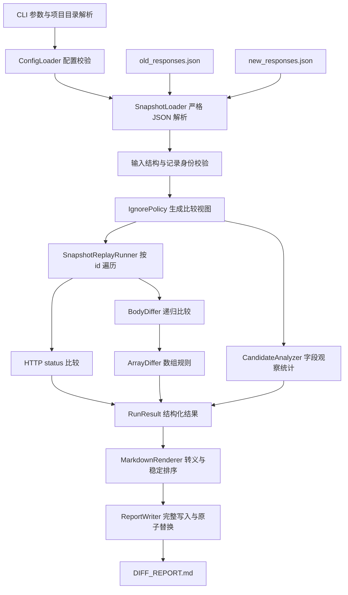

# 接口回放与响应 Diff 系统技术方案

文档日期：2026-10-19。

文档状态：实现依据；Python 程序、配置、运行脚本及测试已经按本方案编写，实际验证结果见 `TEST_REPORT.md`。

## 1. 需求依据与交付范围

### 1.1 本地依据

| 文件 | 本方案采用的要求 |
| --- | --- |
| `PROBLEM.md` | 按 `id` 配对两份 JSON，识别五类差异，通过配置忽略动态字段，生成 `DIFF_REPORT.md`，支持三项进阶能力 |
| `README.md` | 数据为 JSON 数组，每份包含 7 条响应记录，明确四个动态字段 |
| 上级目录 `README.md` | 在当前题目目录编辑交付文件；`.vibecoding/` 由已有 CLI 管理 |
| `resources/old_responses.json` | 旧版响应基准 |
| `resources/new_responses.json` | 新版待比较响应 |

### 1.2 功能清单与验收对应关系

| 编号 | 功能 | 设计位置 | 验收依据 |
| --- | --- | --- | --- |
| FR-01 | 读取并校验两份 JSON，以 `id` 配对记录 | 第 4、5 节 | 输入顺序变化不影响配对；重复 `id` 立即终止 |
| FR-02 | 比较 HTTP status | 第 7 节 | `req_004` 产生 `200 → 201` |
| FR-03 | 比较字段新增、删除、类型、数值或内容变化 | 第 7 节 | 五类差异分别具有独立用例 |
| FR-04 | 从配置读取动态字段忽略规则 | 第 6 节 | 默认四个字段全部忽略；修改配置即可改变行为 |
| FR-05 | 生成 Markdown 汇总和逐条差异明细 | 第 10 节 | 总记录数、差异记录数、相同记录数及字段路径准确 |
| FR-06 | 字段名通配符 | 第 6 节 | `*_at` 匹配 `created_at`、`updated_at` |
| FR-07 | 数组忽略顺序 | 第 8 节 | 重复元素数量、元素类型、对象字段变化均被保留 |
| FR-08 | 提示疑似动态字段 | 第 9 节 | 有明确样本分母、触发条件及独立提示区域 |
| FR-09 | 一键运行及命令行参数 | 第 11 节 | Windows PowerShell 与 Python 命令均有明确入口 |
| FR-10 | 多轮回归及可重复运行 | 第 12、13 节 | 固定输入生成相同报告；实际文件和子进程完成验收 |

### 1.3 回放的输入与执行方式

当前执行单位为已经采集的响应记录。`SnapshotReplayRunner` 按确定顺序读取旧、新快照中的记录，将每组记录交给比较引擎，完成离线回放与分析。

`request.method`、`request.path` 用于标识请求、校验配对关系及展示报告。当前资源具有 POST、PUT 记录，其请求信息只有 method、path；实际 HTTP 请求执行所需的目标地址、headers、请求 body、认证及环境数据没有提供。本交付流程使用资源中已经保存的响应。

完整交付包含必做功能、三项进阶能力、输入校验、可重复报告和回归测试。核心比较算法由 Python 编写；JSON 解析、通配符匹配等成熟格式和通用能力使用现有库。

## 2. 多轮 Plan 规划与设计检查

每轮具有明确输入、检查内容、产出和通过条件。设计检查贯穿本文件；运行验证安排在第 13 节，开发完成后逐轮执行并记录证据。

| 轮次 | 输入 | 详细检查内容 | 产出 | 通过条件 |
| --- | --- | --- | --- | --- |
| Plan-01：需求检查 | 两份 README、PROBLEM | 列出必做、进阶、交付物；确认回放的数据来源、配对字段、忽略规则配置方式 | FR-01～FR-10、范围说明 | 每项题目要求都有设计位置和验收方法 |
| Plan-02：资源核对 | 两份原始 JSON | 按 `id` 核对 method、path、status、body；人工列出差异；计算动态字段出现次数 | 第 3 节的预期表与输入 SHA-256 | 7 条记录全部覆盖；预期差异能够逐项对应资源 |
| Plan-03：比较规则检查 | 需求及预期表 | 明确 JSON 类型、缺失与 null、父级新增删除、路径、数字精度、三种数组规则、提示条件 | 第 4～9 节 | 每个分支具有唯一行为；默认规则生成 10 条差异 |
| Plan-04：执行与报告检查 | 比较规则 | 检查参数、错误终止、输入保护、完整写入、稳定排序、Markdown 转义、资源上限 | 第 10、11、14 节 | 异常具有明确结果；报告完整且可重复；输入内容保持一致 |
| Plan-05：回归与交付检查 | 全部设计 | 检查边界用例、真实文件测试、独立预期、随机性质验证、执行顺序和最终证据 | 第 12、13、15 节 | 功能、配置、报告、失败流程均有测试；没有使用运行结果自动充当预期 |

设计中的固定决策如下：

1. 记录按 `id` 配对，总记录数取两个 `id` 集合的并集大小。
2. body 使用 JSON 的六类类型进行比较，保留 string、number、boolean 的差别。
3. 新增、删除及类型变化在当前节点输出一次；共同存在且类型相同时继续递归。
4. 忽略规则在 body 的全部对象层级生效，同时用于容器值展示和数组匹配。
5. 默认数组按索引比较；配置支持忽略顺序及按明确身份字段配对。
6. 疑似动态字段只产生提示，正式差异始终完整保留。
7. 成功报告采用确定排序；错误立即终止本次运行。

## 3. 当前资源的逐条核对

### 3.1 默认配置下的预期

默认 `ignore_fields` 为 `timestamp`、`traceId`、`request_id`、`created_at`，数组默认使用 `ordered`。

| 记录 | 请求 | 必须报告的变化 | 差异条数 |
| --- | --- | --- | --- |
| `req_001` | GET `/api/articles/1` | `data.author_email` 删除；`data.like_count` 从 string 变为 number；`data.updated_at` 新增 | 3 |
| `req_002` | GET `/api/articles/2` | `data.author_email` 删除；`data.like_count` 从 string 变为 number；`data.updated_at` 新增 | 3 |
| `req_003` | GET `/api/articles` | `data.items` 删除；`data.total` 删除；`data.data` 新增 | 3 |
| `req_004` | POST `/api/articles` | `response.status` 从 200 变为 201 | 1 |
| `req_005` | GET `/api/articles/999` | 无差异 | 0 |
| `req_006` | PUT `/api/articles/1` | 无差异 | 0 |
| `req_007` | POST `/api/articles` | 无差异 | 0 |

汇总预期：总记录数 7，有差异数 4，无差异数 3，字段及状态差异总数 10。

| 差异类型 | 条数 |
| --- | --- |
| 状态码变更 | 1 |
| 字段删除 | 4 |
| 字段新增 | 3 |
| 字段类型变更 | 2 |
| 字段值变更 | 0 |

资源中的 `req_003` 从 `data.items`、`data.total` 变为 `data.data.list`、`data.data.total`。按当前节点的存在性规则，报告三条结构差异，并在旧值、新值中完整展示相关容器。新增容器内部的数字类型也通过完整内容展示；跨路径的字段迁移没有确定的配对身份，因此报告采用已经确认的新增、删除事实。

资源没有独立的字段值变更案例，该功能通过额外的明确输入用例验收。

### 3.2 配置变化对应的预期

| 配置情形 | 差异记录数 | 相同记录数 | 差异总数 | 解释 |
| --- | --- | --- | --- | --- |
| 默认四个字段 | 4 | 3 | 10 | 保留 `updated_at` 的两条新增差异 |
| `ignore_fields` 为空数组 | 7 | 0 | 33 | 增加 23 条动态字段值变更 |
| 默认配置额外加入 `*_at` | 4 | 3 | 8 | `updated_at` 的两条新增差异也被忽略 |

每份资源内，`timestamp`、`traceId`、`request_id` 各出现 7 次，`created_at` 出现 2 次，共 23 个忽略字段。默认配置的命中统计为旧版 23、新版 23。

`*_at` 为用户主动扩大忽略范围的规则。默认配置仅列出题目指定的四个字段，以保留 `updated_at` 的结构变化。

### 3.3 资源版本

以下为本次设计核对时的文件内容 SHA-256，便于后续判断固定预期是否适用于当前资源：

| 文件 | SHA-256 |
| --- | --- |
| `resources/old_responses.json` | `736C01D5C26BB4A6AA2E641A3397676823760211C7EEBBBBA519BFB3BFE008F3` |
| `resources/new_responses.json` | `3ab810cab06b76fcdf18dd3c3401c2b04804b6d88284f5ba730bf2af10dea3de` |

固定资源回归会直接核验完整 SHA-256。资源发生变化时，应根据新文件逐项审核预期，并保留实际测试所使用的资源版本。

## 4. Python 组件与数据流程

### 4.1 使用的技术

| 事项 | 选择 | 使用理由 |
| --- | --- | --- |
| 语言 | Python 3.11 及以上 | `dataclasses`、类型注解、命令行及文件能力能够支持当前工具 |
| JSON | `simplejson`，明确设置 Decimal 与严格解析参数 | 保留十进制精度；库负责完整 JSON 解析和序列化 |
| 数字 | `int`、`decimal.Decimal` | 整数和小数都归入 JSON number，比较时保持精度 |
| 配置格式 | JSON | 与输入文件一致；字段结构明确 |
| 通配符 | 标准库 `fnmatch.fnmatchcase` | 字段名匹配区分大小写，Windows 和 Linux 使用相同规则 |
| 命令行 | 标准库 `argparse`、`pathlib` | 明确参数、项目相对路径和错误提示 |
| 核心结构 | `dataclasses`、`Enum`、typed path segments | 统一比较结果与报告输入 |
| 测试 | `pytest`、`pytest-cov`、`hypothesis`、`markdown-it-py` | 单元、覆盖率、性质测试及 Markdown 结构校验 |
| 发布形式 | 本地命令行程序、PowerShell 脚本 | 适合当前文件输入及一键运行要求 |

依赖文件固定经过测试的具体版本；代码要求 Python 3.11 及以上，当前实际回归使用的 Python 版本与兼容性验证范围见 `TEST_REPORT.md`。

### 4.2 组件关系



### 4.3 模块职责

| 文件或目录 | 职责 |
| --- | --- |
| `response_diff/__main__.py` | 接收参数，依次调用组件，确定正常运行的退出状态 |
| `response_diff/models.py` | 定义输入记录、路径、差异、观察统计及运行结果 |
| `response_diff/config.py` | 加载配置、填充通用默认值、拒绝未知字段与冲突规则 |
| `response_diff/loader.py` | 使用 JSON 库读取文件、检查重复键、验证输入结构 |
| `response_diff/ignore.py` | 生成经过忽略规则处理的 body 副本及命中计数 |
| `response_diff/runner.py` | 构建 `id` 索引、遍历并集、比较 status、组织每条结果 |
| `response_diff/differ.py` | 对象、标量、缺失、类型的比较 |
| `response_diff/arrays.py` | ordered、unordered、按 match_key 配对 |
| `response_diff/candidates.py` | 聚合疑似动态字段的观察结果 |
| `response_diff/report.py` | 生成 Markdown 并发布完整报告 |
| `config.json` | 默认四个动态字段、数组规则、提示参数及资源限制 |
| `run.ps1` | 使用当前 Python 环境运行默认输入，传递额外参数与退出状态 |
| `test.ps1` | 指定项目内测试目录，执行完整回归，保存命令结果 |
| `pyproject.toml`、依赖锁定文件 | 项目元数据、固定依赖及 pytest 配置 |
| `tests/` | 单元、文件集成、CLI、报告、性质和容量测试 |
| `.cache/` | 测试运行目录、中间文件、性能证据及测试日志 |

模块按职责组织；全部运行过程为单进程。当前输入使用内存索引和递归遍历即可完成。

### 4.4 核心数据模型

| 模型 | 关键字段 | 说明 |
| --- | --- | --- |
| `ResponseRecord` | `id`、`description`、`request_method`、`request_path`、`status`、`body` | 已完成结构校验的输入记录 |
| `PathSegment` | `kind`、`value` | `key` 保存原始字段名；`index` 保存整数索引 |
| `DiffEntry` | `kind`、`scope`、`old_path`、`new_path`、`old_present`、`new_present`、`old_value`、`new_value`、`old_type`、`new_type` | `scope` 为 `status`、`body`、`record`；缺失与 null 独立表达 |
| `RecordResult` | `id`、请求展示信息、`diffs`、`presence` | `presence` 为 `both`、`old_only`、`new_only` |
| `FieldObservation` | 请求分组、标准路径、出现数、可比较数、变化数、类型变化数 | 疑似动态字段统计的原始依据 |
| `RunResult` | 记录统计、各类差异统计、逐条结果、提示、输入及配置 SHA-256、忽略命中数 | 报告渲染只读取该结果 |

`DiffKind` 至少包含 `STATUS_CHANGED`、`FIELD_REMOVED`、`FIELD_ADDED`、`TYPE_CHANGED`、`VALUE_CHANGED`。记录集合变化使用 `RECORD_REMOVED`、`RECORD_ADDED`。

缺失使用内部唯一 `MISSING` sentinel，报告通过 presence 字段判断“字段不存在”。JSON `null` 对应 `None`，保持其正常类型和值。

## 5. 输入校验、记录配对与错误终止

### 5.1 JSON 读取

1. 读取文件 bytes，在大小限制内计算 SHA-256，并解码为 UTF-8；允许 UTF-8 BOM，输出统一使用无 BOM 的 UTF-8。
2. 使用 `simplejson` 解析，明确设置 `use_decimal=True`、`allow_nan=False`。
3. 使用 `object_pairs_hook` 检查对象内重复字段名，发现重复立即抛出 `InputValidationError`。该函数处理库已经解析的键值对。
4. 非法 JSON、尾随非空白内容、非法编码、NaN、Infinity、重复键均终止运行。
5. 遍历解析结果检查深度、节点数、字符串合法性；拒绝未配对 Unicode surrogate，保证报告能够写入 UTF-8。
6. 标准 JSON 库可能在极深输入上提前抛出递归异常，此异常同样立即终止运行；项目层的深度限制在解析成功后检查。

### 5.2 记录结构

| 位置 | 要求 |
| --- | --- |
| 文件根节点 | JSON array；允许空数组 |
| 每条记录 | JSON object |
| `id` | 非空 string；每份文件内部唯一；保持原始内容，不执行自动去空白 |
| `description` | string；允许空字符串 |
| `request` | object |
| `request.method` | 非空 string；采用大写 HTTP method，包含 GET、POST、PUT、PATCH、DELETE、HEAD、OPTIONS、CONNECT、TRACE |
| `request.path` | 以 `/` 开始的非空 string；按原始内容处理 |
| `response` | object |
| `response.status` | Python 类型严格为 int，数值在 100～599；boolean 和小数均不接受 |
| `response.body` | 字段必须存在，值允许六类 JSON 类型 |

输入记录允许附带其他元数据，其原始内容不参与 body Diff。配置文件的未知配置字段直接报错，及时发现拼写问题。

### 5.3 配对与元数据

旧、新记录各建立 `dict[id, ResponseRecord]`，按 `sorted(old_ids ∪ new_ids)` 的顺序回放。

| 情形 | 行为 |
| --- | --- |
| 两边都有相同 `id` | 比较 status 和 body |
| 仅旧版包含某个 `id` | 产生一条 `RECORD_REMOVED`，计入差异记录 |
| 仅新版包含某个 `id` | 产生一条 `RECORD_ADDED`，计入差异记录 |
| 同一份文件出现重复 `id` | 抛出校验异常，终止运行 |
| 相同 `id` 的 method 或 path 不一致 | 抛出身份校验异常，终止运行 |
| 相同 `id` 的 description 不一致 | 报告展示新版 description，并附旧版 description；响应差异计数保持独立 |

method、path 的相等比较不执行路径重写或路由推测。

设共同记录数为 `C`，仅旧版数量为 `R`，仅新版数量为 `A`，则总记录数为 `T = C + R + A`。设共同记录中有差异数为 `D`，则有差异数为 `D + R + A`，无差异数为 `C - D`。始终满足总记录数等于有差异数与无差异数之和。

## 6. 配置设计与动态字段处理

### 6.1 默认配置示例

```json
{
  "schema_version": 1,
  "ignore_fields": ["timestamp", "traceId", "request_id", "created_at"],
  "arrays": {
    "default_mode": "ordered",
    "rules": []
  },
  "dynamic_candidates": {
    "enabled": true,
    "min_samples": 3
  },
  "limits": {
    "max_file_bytes": 20971520,
    "max_records": 10000,
    "max_depth": 100,
    "max_nodes": 1000000,
    "max_array_items": 10000,
    "max_diff_entries": 100000,
    "max_report_bytes": 52428800
  }
}
```

资源限制为完整方案的可配置初始值，属于设计参数；性能表现需要后续测量。`max_records`、`max_nodes` 分别限制单份输入；深度以 body 根节点为第 0 层；数组长度限制适用于每个数组；差异数和报告字节数限制适用于一次运行。

`ignore_fields` 为必填字段，允许空数组。其余配置项省略时使用配置层定义的通用默认值。核心比较逻辑只读取 `DiffConfig`，题目指定的四个名称保存在交付配置文件中。

### 6.2 字段忽略规则

- 匹配对象为 response body 内每个 object 的字段名称，包含数组元素内部的字段。
- 所有模式按 OR 组合，匹配成功后忽略该字段及其完整子节点。
- 区分大小写；`traceId` 与 `traceid` 为不同名称。
- 精确名称和通配符均交给 `fnmatchcase` 处理。支持 `*`、`?`、`[seq]`、`[!seq]`，字面量特殊字符采用该库的方括号表达方式。
- `*_at` 在任意 body object 层级匹配以 `_at` 结尾的字段名。
- 规则范围为 body；HTTP status、记录 `id`、request 元数据维持其固定处理规则。
- 忽略字段的新增、删除、类型和值变化均不产生差异。
- 模式必须为非空 string；不执行空白裁剪或大小写转换；重复模式属于配置错误。

### 6.3 比较视图与原始输入

`IgnorePolicy` 遍历 body 并创建独立副本，移除所有命中的对象字段。原始输入对象和资源文件均保持原始内容。

处理后的副本同时用于核心比较、数组元素匹配、疑似动态字段统计和报告值展示。父级对象整体新增、删除或改变类型时，报告携带的对象及数组内容已经经过相同处理。

对象全部字段被忽略后，保留空 object；数组元素全部字段被忽略后，保留对应空 object 及其出现次数。数组长度和容器存在性具有独立意义。

命中数按实际移除的字段计数。字段被移除后，其子节点不再遍历统计。报告只展示旧版、新版总命中次数及配置 SHA-256，保证被忽略字段不会通过配置列表出现在运行报告正文中。

### 6.4 数组规则配置

```json
{
  "ignore_fields": ["timestamp", "traceId", "request_id", "created_at"],
  "arrays": {
    "default_mode": "ordered",
    "rules": [
      {"path": ["data", "tags"], "mode": "unordered"},
      {"path": ["data", "items"], "mode": "unordered", "match_key": ["id"]},
      {"path": ["data", "groups", null, "members"], "mode": "unordered", "match_key": ["user_id"]}
    ]
  }
}
```

`path` 相对于 body 根节点。string 表示 object key，非负 int 表示数组索引，`null` 表示任意数组索引；空数组表示 body 根节点。字段名中的句点、方括号、斜杠均按原始 string 保存。

路径使用已经由 JSON 库解析的 segment 列表，匹配时逐段检查。内部路径对象负责保存和展示路径，配置处理无需解析自定义路径字符串。

数组规则遵循以下约束：

1. `mode` 只允许 `ordered`、`unordered`；`match_key` 只用于 `unordered`。
2. `match_key` 为非空字段名称列表，用于读取每个对象元素内部的嵌套身份字段，如 `["user", "id"]`。
3. 相同长度且能够匹配同一路径的两条规则属于冲突配置，启动时立即终止；不同长度表示不同层级的数组。
4. 匹配不到显式规则时使用 `default_mode`。规则未命中当前输入时允许正常执行，方便同一配置服务多批数据。
5. 数组规则只应用于实际 array 节点。目标或祖先不存在时没有需要应用的数组规则；目标为其他类型时，按照存在性与 JSON 类型规则比较。
6. 对 `unordered` 数组内部的规则，跨越该数组的路径必须使用 `null`，保证匹配逻辑不依赖元素重排后的索引。使用具体索引属于配置错误。
7. `match_key` 的任何字段名称被忽略模式覆盖时，配置校验失败。

## 7. 字段比较算法

### 7.1 JSON 类型

| JSON 类型 | Python 表达 | 比较原则 |
| --- | --- | --- |
| object | dict | key 顺序无意义；按共同 key 递归 |
| array | list | 使用当前路径的数组模式 |
| string | str | 按字符串内容精确比较 |
| number | int、Decimal | 按精确数值比较 |
| boolean | bool | 保持独立类型 |
| null | None | 只与 null 相等 |

类型判定显式区分 bool 与 int。`true → 1` 为类型变化，`"128" → 128` 为类型变化，`1 → 1.0` 为相同 number 值，`0 → -0` 为相同 number 值。

不进行字符串数字转换、时间格式转换、字符串裁剪、大小写转换、数值容差或 Unicode 归一化。

### 7.2 单节点判定顺序

对处理后的两个节点执行以下判断：

1. 旧值缺失、新值存在：产生 `FIELD_ADDED`，保存新值和类型。
2. 旧值存在、新值缺失：产生 `FIELD_REMOVED`，保存旧值和类型。
3. 两边 JSON 类型不同：产生 `TYPE_CHANGED`，保存两边类型和值，完成该节点处理。
4. 两边为 object：遍历 key 并集，按确定顺序对子字段重复判断。
5. 两边为 array：调用 `ArrayDiffer`。
6. 两边为同类型标量：精确比较；不相等时产生 `VALUE_CHANGED`。

HTTP status 在 body 之外单独比较，不受字段忽略规则影响。status 和 body 同时变化时，两部分差异全部保留。

### 7.3 父级与子级的报告范围

object、array 或标量字段整体新增、删除时，在该字段路径产生一条差异。object 变为 array、null 或其他类型时，在该字段路径产生一条类型变化。

例如 `data.profile` 从 object 变为 null，报告一条 `data.profile` 类型变化，并保存经过忽略规则处理后的完整旧 object 和新版 null。

该规则使每次递归分支具有确定的计数方式。报告覆盖范围以“整个节点的内容”或“共同节点内的子字段变化”表达。

### 7.4 路径表示

内部保存 typed segments，报告展示 body 相对路径：

| 数据位置 | 报告路径 |
| --- | --- |
| 普通对象字段 | `data.author_email` |
| 数组元素字段 | `data.items[0].like_count` |
| 名称包含句点的字段 | `data["a.b"]` |
| 名称为数组形式文字的字段 | `data["items[0]"]` |
| 空字段名称 | `data[""]` |
| body 根节点 | `$body` |
| HTTP status | `response.status`，比较对象列为 HTTP |
| 整条记录新增或删除 | `$record`，比较对象列为 record |

普通字段名称采用 ASCII identifier 规则 `[A-Za-z_][A-Za-z0-9_]*`；其他名称通过 JSON 库序列化为方括号内的 string。字段名称不翻译。

`DiffEntry.scope` 区分 HTTP、body 和 record。body 中同名 `response.status` 与 HTTP status 在报告的“比较对象”列中分别展示。

## 8. 数组比较的完整规则

### 8.1 ordered：默认按索引比较

设旧、新数组长度为 `m`、`n`：

1. `[0, min(m, n))` 范围内逐个递归。
2. 旧数组剩余元素逐个报告 `FIELD_REMOVED`，保留旧索引。
3. 新数组剩余元素逐个报告 `FIELD_ADDED`，保留新索引。

空数组、混合类型数组、嵌套数组均使用相同规则。中间插入引起后续索引对应内容变化时，报告按照索引语义生成；需要对象身份配对的路径配置 `unordered` 和 `match_key`。

### 8.2 unordered：保留重复次数的集合比较

没有 `match_key` 时，忽略顺序，同时保留每个元素的类型、完整内容和出现次数。

1. 对每个元素生成包含 JSON 类型信息的不可变结构签名。
2. object 签名按 key 排序；数组签名递归使用该子数组自身的规则；number 签名采用精确数值等价关系，boolean 带有独立类型标签。
3. ordered 子数组保持元素次序；unordered 子数组对元素签名计数。
4. 使用签名到元素出现位置队列的映射，逐个消除相同元素。
5. 旧版剩余元素按旧索引产生删除，新版剩余元素按新索引产生新增。

签名保存完整结构信息；哈希表的哈希值仅用于查找，结构相等判定继续使用完整签名。数字比较与签名必须采用相同规则，例如 `1` 和 `1.0` 消除为同一个 number，`true` 和 `1` 保持不同元素。

`[1, 1, 2]` 与 `[2, 1, 1]` 相同；`[1, 1, 2]` 与 `[1, 2]` 有一条元素删除。没有身份字段的两个不同 object 分别表示元素删除和新增，其完整内容和原始索引保留在报告中。

### 8.3 unordered + match_key：按对象身份比较

适用于对象列表，例如通过 `["id"]` 标识 `data.items` 中的元素。

1. 每个数组元素必须为 object。
2. 每个元素的身份字段必须存在，且为非 null 的 string、number 或 boolean；身份键包含类型信息。
3. 同一个数组内身份值必须唯一，`number 1` 与 `number 1.0` 视为同一个身份；重复时立即终止。
4. 建立旧、新身份索引，共同身份对应的对象递归比较。
5. 仅旧版存在的身份产生元素删除，仅新版存在的身份产生元素新增。
6. 对象顺序变化时，共同身份对应的内容相同则没有差异；内容变化则报告具体字段。

旧、新索引保存在 `old_path`、`new_path`。同一元素移动并发生字段变化时，路径单元格同时展示旧、新位置，例如 `data.items[0].name → data.items[2].name`。相同位置只展示一次路径。

`match_key` 的值变化时，对象身份也随之变化，因此产生一个元素删除和一个元素新增。

### 8.4 嵌套规则与身份检查

相同身份的 object 内部包含数组时，该数组继续按自身路径配置执行。所有现有数组的规则、身份字段及重复身份在开始比较前完成检查，包含位于整体新增、删除容器内部的数组。

预检查使错误配置或错误数据能够在明确位置终止；核心递归不会因为上级节点整体变化而遗漏输入规则校验。

## 9. 疑似动态字段提示

### 9.1 样本分组

按精确 `(request.method, request.path)` 分组，再按 body 字段路径统计。数组索引统一替换为内部 `any_index` segment，以聚合同类元素字段。

每条匹配记录在同一标准路径最多贡献一个样本。数组路径只有在两边身份可以明确配对时参与统计：ordered 使用索引，带 `match_key` 的 unordered 使用身份；没有身份字段的 unordered 元素字段不参与该提示统计。

### 9.2 触发条件

某个路径同时满足以下条件，报告为“疑似动态字段”：

1. 提示功能已经启用；该字段未被忽略配置覆盖。
2. 所在请求分组至少包含 `min_samples` 条共同记录，默认 3。
3. 该路径在分组的每条记录中，两边都存在；类型始终一致，且全部为非 null 标量。
4. 每条记录内该路径的所有有效配对值都不同；数组存在未配对元素、字段缺失或空数组时，该记录不满足要求，整个候选无法触发。
5. 该路径没有字段新增、删除或类型变化观察。

报告展示请求分组、路径、样本数、变化样本数、比例及“疑似动态字段，需人工确认”。例如同一 GET 路径的 3 条记录中 `generated_at` 始终从旧时间变为新时间，展示 `3/3，100%`。

该提示仅证明观察样本符合上述条件。业务字段也可能在全部样本中变化，因此提示不会修改配置，也不会减少正式差异。

### 9.3 当前资源的提示预期

当前精确请求分组中，最多有 2 条共同记录；默认样本下限为 3。因此默认资源报告的疑似动态字段提示数量为 0。该进阶功能使用同一路径至少 3 条记录的专门用例验收。

`like_count` 的 string → number 类型变化始终保留为类型差异，且无法进入上述候选条件。

## 10. Markdown 报告

### 10.1 内容结构

`DIFF_REPORT.md` 包含以下内容：

1. 报告标题、报告格式版本、旧版输入 SHA-256、新版输入 SHA-256、有效配置 SHA-256。
2. 记录汇总：总记录数、有差异数、无差异数、共同记录数、记录新增数、记录删除数。
3. 差异分类统计：五类响应差异及两类记录集合变化；另外展示差异明细总条数。
4. 忽略处理统计：旧版命中数、新版命中数。
5. 差异记录明细：记录 `id`、description、method、path；表格列出比较对象、字段路径、差异类型、旧值、新值。
6. 无差异记录清单：`id` 及请求描述。
7. 疑似动态字段提示：符合条件时展示明细；没有候选时明确显示数量为 0。

整条记录新增或删除时，保存现有一侧的 response status 与经过忽略规则处理的 body；对应 request 信息放在记录标题中。

### 10.2 值表示

| 值 | 展示方式 |
| --- | --- |
| 字段缺失 | `字段不存在` |
| JSON null | `null` |
| string | `string "128"` |
| number | `number 128` |
| boolean | `boolean true` |
| object | `object` 后接 key 排序的完整 JSON |
| array | `array` 后接完整 JSON |

容器内容通过 `simplejson` 序列化，显式启用 `use_decimal=True`、`ensure_ascii=False`、`sort_keys=True`、`allow_nan=False`。展示保留原始数字表示能够表达的精度，比较依照精确数值。

不截断旧值、新值。达到报告大小上限时终止本次运行，保留异常信息；用户可通过明确提高配置限制处理更大的输入。

### 10.3 Markdown 转义与稳定输出

- 输入提供的 description、method、path、字段名和值均视为普通文本，进行 Markdown 和 HTML 特殊字符转义。
- 表格中的 `&`、`<`、`>`、竖线、反引号、反斜杠、换行及其他会改变 Markdown 结构的字符采用统一转义流程；JSON 字符串中的控制字符交给 JSON 库转义。
- 表格单元格中的文本通过 HTML entity 或字符实体表达，防止数据创建新表格列或原始 HTML 元素。
- 记录按 `id` 的 Unicode 顺序输出；status 差异在 body 之前。
- body 差异按 typed path segment 排序，key 使用 Unicode 顺序，index 使用整数顺序；相同位置使用固定 `DiffKind` 顺序。
- unordered 配对产生的剩余元素按来源索引排序；候选提示按请求分组及标准路径排序。
- 报告使用 UTF-8、LF 换行并保留文件末尾换行。
- 报告正文不写当前时间、运行耗时、随机值、绝对机器路径。运行时间与耗时写入单独的测试或运行日志。

相同输入 bytes、相同有效配置、相同报告格式版本，报告 bytes 必须一致。仅重排输入记录时，报告明细和统计必须一致；输入 SHA-256 会随原始 bytes 变化。

### 10.4 文件发布

输入、配置、输出路径在启动时解析为绝对路径。输出路径与任意输入、配置文件指向相同文件时立即终止，包含可以识别的符号链接及已有文件别名。

全部计算和渲染成功后，将报告 bytes 写入 `.cache/report-staging/` 下唯一命名的 `.tmp` 文件，flush 并关闭文件，再用 `os.replace` 替换最终输出。中间文件与输出要求位于同一文件系统，配置到其他文件系统的输出路径在执行前检查并终止。

写入或替换失败时异常立即传播，本次运行不会输出成功提示。已有完整报告保持其已完成版本，调用方必须检查本次退出状态及输入、配置 SHA-256。测试目录和报告中间目录均属于现有 `.cache/` 忽略范围。

同一输出路径由单个运行进程负责；并发执行使用不同输出路径。成功运行会在 stdout 输出本次汇总与最终报告位置。

## 11. 命令行与运行行为

### 11.1 计划提供的入口

以下命令为已经提供的运行入口，默认使用项目目录内的数据与配置。

```powershell
python -m response_diff
```

默认读取项目目录内的 `resources/old_responses.json`、`resources/new_responses.json`、`config.json`，输出项目目录内的 `DIFF_REPORT.md`。

```powershell
python -m response_diff --old resources/old_responses.json --new resources/new_responses.json --config config.json --output DIFF_REPORT.md --fail-on-diff
```

```powershell
.\run.ps1
```

相对参数路径统一相对于项目目录解释。`run.ps1` 根据自身所在位置确定项目目录，并在子进程执行时使用该工作目录，所有额外参数原样传递。

脚本执行前校验 Python 版本及依赖可用性；缺失依赖立即终止并显示依赖文件的安装命令。依赖安装作为明确的环境准备步骤，不在运行报告时自动修改环境。

### 11.2 退出状态

| 退出码 | 含义 |
| --- | --- |
| 0 | 完整报告已经生成；默认模式下允许存在差异 |
| 3 | 使用 `--fail-on-diff`，完整报告已经生成且存在差异 |
| 2 | `argparse` 判定命令行参数无效 |
| 1 | 读取、解析、数据校验、配置校验、比较或写入出现未处理异常，运行立即终止 |

核心组件在错误位置抛出具有文件、记录 `id`、相关路径的异常，正常比较结果由数据模型返回。异常不触发重试、替代输入或部分成功报告。

`--fail-on-diff` 模式下零差异返回 0。疑似动态字段提示单独存在时不会触发退出码 3。PowerShell 脚本传播 Python 子进程的退出码。

### 11.3 错误信息

校验异常包含可定位的信息，例如输入文件、记录数组索引、`id` 和字段路径。JSON 语法错误保留库提供的行号、列号。

诊断信息包含错误位置和原因；输入 body 内容通过正常报告展示。报告输出失败时保留已有文件，错误发生后立即终止。

## 12. 测试设计与独立预期

### 12.1 测试执行规则

所有测试直接执行实际比较组件、实际文件读写和实际 CLI 子进程。每份额外 JSON 都是明确声明的测试输入，预期由人工分析的规则表或独立数学性质给出。

测试不替代比较函数、JSON 库、文件系统或 CLI 返回值。错误测试通过无效输入、实际不存在的输入文件、实际目录路径、真实冲突配置等触发。环境权限差异无法可靠制造的异常，应记录适用平台和实际执行证据。

pytest 的临时目录明确指定到项目 `.cache/test-runs/<run_id>/`。`test.ps1` 为每次执行生成唯一 `run_id`，设置 `TMP`、`TEMP`、`TMPDIR` 到同一个项目内目录，并传给测试子进程。覆盖率、Hypothesis 数据库及测试日志也保存在 `.cache/` 内。

测试数据及预期组织如下：

| 位置 | 内容 |
| --- | --- |
| `tests/fixtures/` | 手工编写、规模明确的 JSON 输入和配置 |
| `tests/expected/resource_default.json` | 当前资源的 10 条差异事件及 7 条记录状态，独立于引擎填写 |
| `tests/expected/resource_default_report.md` | 人工审核的默认资源完整报告 |
| `tests/unit/` | JSON 类型、字段递归、配置、数组、候选、排序与转义 |
| `tests/integration/` | loader 到 writer 的实际文件流程 |
| `tests/cli/` | 子进程参数、退出码、报告、工作目录 |
| `tests/properties/` | Hypothesis 生成的合法 JSON 与不变量 |
| `tests/performance/` | 确定规模的输入、耗时、峰值内存及输出大小 |

固定预期禁止在测试启动时调用生产比较代码生成。完整报告快照更新需要核对结构化事件、人工预期与实际资源。

### 12.2 原始资源回归

| 编号 | 输入或操作 | 必须断言 |
| --- | --- | --- |
| RES-01 | 原始资源、默认配置 | 7/4/3；10 条差异；分类数量为 1/4/3/2/0 |
| RES-02 | 检查每条差异 | `id`、scope、路径、类型、presence、旧值和新值逐项符合第 3 节 |
| RES-03 | 检查相同记录 | 仅 `req_005`、`req_006`、`req_007` 无差异 |
| RES-04 | 检查忽略字段 | 报告路径、容器值、提示均没有四个被忽略字段；旧、新命中数各 23 |
| RES-05 | 空忽略规则 | 7/7/0；33 条差异；增加的 23 条均为值变化 |
| RES-06 | 默认配置加入 `*_at` | 7/4/3；8 条差异；两条 `updated_at` 新增被忽略 |
| RES-07 | 将 old 同时作为两边 | 7/0/7；0 条差异 |
| RES-08 | 固定输入连续运行 3 次 | 三份报告 bytes 与 SHA-256 完全一致 |
| RES-09 | 仅重排记录顺序 | 配对、明细及计数一致；允许输入 SHA-256 变化 |
| RES-10 | 运行前后计算原始文件 SHA-256 | 输入文件内容完全一致 |
| RES-11 | 默认疑似动态字段统计 | 提示数量为 0 |

### 12.3 类型、存在性与递归

| 编号 | 输入重点 | 必须断言 |
| --- | --- | --- |
| DIF-01 | status 200 → 201，body 相同 | 一条 `STATUS_CHANGED` |
| DIF-02 | status 和 body 字段同时变化 | 两部分差异均存在 |
| DIF-03 | string `"128"` → number 128 | 一条 `TYPE_CHANGED`，保留两个原始类型 |
| DIF-04 | boolean true → number 1 | 一条 `TYPE_CHANGED` |
| DIF-05 | 六类 JSON 类型的所有不同类型组合 | 每个组合恰有一条类型变化 |
| DIF-06 | number 1 → 2；string `"a"` → `"b"`；boolean true → false | 分别为 `VALUE_CHANGED` |
| DIF-07 | number 1 → 1.0；0 → -0 | 无差异 |
| DIF-08 | 相邻大整数；高精度小数相邻末位 | 精确识别数值变化 |
| DIF-09 | null → null；缺失 → null；null → 缺失 | 分别无差异、新增、删除 |
| DIF-10 | object → null；array → object | 在当前节点各报告一条类型变化 |
| DIF-11 | 深层单个字段变化 | 路径完整，父级没有额外重复差异 |
| DIF-12 | 新增、删除包含多层对象的字段 | 每个整体节点一条；值包含完整比较视图 |
| DIF-13 | 空 object、空 array、空 string、null | 四种类型区分正确 |
| DIF-14 | object key 插入顺序变化 | 无差异 |
| DIF-15 | 字段名包含句点、引号、方括号、斜杠、空字符串或中文 | 内部路径不混淆，报告路径可读 |
| DIF-16 | body 根节点为六类值 | 根节点比较及 `$body` 展示正确 |
| DIF-17 | 比较前后检查传入对象 | 输入对象内容保持一致 |

### 12.4 忽略规则与配置

| 编号 | 输入重点 | 必须断言 |
| --- | --- | --- |
| CFG-01 | 修改临时配置后运行同一输入 | 行为随配置变化，资源输入保持一致 |
| CFG-02 | 动态字段位于不同 object 深度及数组元素内 | 所有命中位置均忽略 |
| CFG-03 | 被忽略字段新增、删除、类型变化、内容变化 | 四种变化全部无差异 |
| CFG-04 | `*_at`、`trace?d`、方括号模式 | 与 `fnmatchcase` 的规则一致 |
| CFG-05 | `traceId` 与 `traceid` | 区分大小写，跨平台一致 |
| CFG-06 | 新增、删除、类型变化的容器中含动态字段 | 完整报告值中没有被忽略字段 |
| CFG-07 | object 字段全部被忽略；数组元素字段全部被忽略 | 保留空容器与元素数量 |
| CFG-08 | 缺少 ignore_fields、错误字段类型、未知字段、重复模式 | 立即终止 |
| CFG-09 | 无效数组模式、ordered 配置 match_key | 立即终止 |
| CFG-10 | 两条数组规则存在重叠 | 启动时立即终止 |
| CFG-11 | 规则路径包含特殊名称和 null 索引模式 | 路径逐段匹配正确 |
| CFG-12 | match_key 被精确忽略规则或通配符覆盖 | 配置错误，立即终止 |
| CFG-13 | unordered 内部规则使用具体外层索引 | 配置错误，立即终止 |
| CFG-14 | 规则目标不存在；array 与非 array 相互变化 | 缺失按新增删除规则处理；类型变化正常报告 |
| CFG-15 | schema_version 不支持；限制值非正数或 boolean | 配置错误，立即终止 |

### 12.5 数组

| 编号 | 输入重点 | 必须断言 |
| --- | --- | --- |
| ARR-01 | ordered 数组尾部新增、删除 | 新增、删除路径及索引正确 |
| ARR-02 | ordered 数组交换两个值 | 按索引产生对应值变化 |
| ARR-03 | ordered object 数组元素字段变化 | 报告字段级路径 |
| ARR-04 | unordered 标量重排 | 无差异 |
| ARR-05 | unordered 重复元素增加或减少 | 每个剩余出现次数各产生一条差异 |
| ARR-06 | unordered 中 string `"1"`、number 1、boolean true | 三类元素保持独立 |
| ARR-07 | unordered 中 1 与 1.0、0 与 -0 | 采用 number 等价关系 |
| ARR-08 | unordered object key 顺序变化及动态字段变化 | 无差异 |
| ARR-09 | unordered 不同 object 且没有身份字段 | 元素删除、新增包含原始索引及完整值 |
| ARR-10 | match_key object 重排 | 无差异 |
| ARR-11 | match_key object 重排且字段变化 | 具体字段变化，旧、新索引准确 |
| ARR-12 | match_key 元素新增、删除 | 对应元素新增、删除 |
| ARR-13 | match_key 缺失、null、object、array、重复或非 object 元素 | 立即终止并指出数组路径 |
| ARR-14 | match_key 为 string `"1"` 与 number 1 | 作为两个独立身份 |
| ARR-15 | number 身份 1 与 1.0 同时出现 | 重复身份异常 |
| ARR-16 | 嵌套 ordered、unordered 与 match_key | 每个层级按自身规则执行 |
| ARR-17 | 空数组与混合类型数组 | 空数组统计、类型差异及路径正确 |
| ARR-18 | 整体新增容器内部含错误 match_key 数组 | 预检查立即终止 |

### 12.6 疑似动态字段

| 编号 | 输入重点 | 必须断言 |
| --- | --- | --- |
| CAN-01 | 同请求组 3 条记录，同一路径同类型且全部变化 | 提示 3/3、100%；正式差异全部存在 |
| CAN-02 | 2 条记录全部变化 | 不达到默认样本下限 |
| CAN-03 | 3 条中仅 2 条变化 | 无候选提示，保留 2 条正式差异 |
| CAN-04 | 路径存在缺失、null、类型变化 | 无候选提示，正式差异按规则产生 |
| CAN-05 | 相同字段来自不同 method 或不同 path | 分组统计独立 |
| CAN-06 | 候选字段已经被配置忽略 | 无候选提示和正式差异 |
| CAN-07 | ordered、match_key 数组中同路径出现多个元素 | 每条记录最多贡献一个样本 |
| CAN-08 | 数组含未配对元素、空数组或缺失字段 | 不满足完整样本条件 |
| CAN-09 | unordered 没有 match_key | 元素内部字段不参与候选统计 |
| CAN-10 | 关闭提示或调整 min_samples | 配置生效；正式差异保持一致 |

### 12.7 输入、报告与 CLI

| 编号 | 输入重点 | 必须断言 |
| --- | --- | --- |
| IO-01 | 根节点非 array、缺少必需字段、错误字段类型 | 立即终止；报告没有成功更新 |
| IO-02 | status 为 true、200.0、99、600 | 立即终止 |
| IO-03 | 重复 id、重复 JSON key | 立即终止，能够定位文件或记录 |
| IO-04 | 非法 JSON、非 UTF-8、NaN、Infinity、未配对 surrogate | 立即终止 |
| IO-05 | UTF-8 BOM、中文内容、合法控制字符转义 | 正常读取并输出有效 UTF-8 |
| IO-06 | 两份输入均为空；只有一份为空 | 分别为 0/0/0；全部记录新增或删除 |
| IO-07 | 共同记录 method 或 path 不一致 | 身份校验异常 |
| IO-08 | description 不同 | 新旧描述展示符合规则；响应统计独立 |
| IO-09 | 输入文件不存在；把目录作为输入文件 | 实际文件操作抛出异常，退出码 1 |
| IO-10 | 输出路径等于输入、配置或已有文件别名 | 启动时终止，原始文件 SHA-256 保持一致 |
| IO-11 | 把已有目录作为报告输出路径 | 实际写入失败，已有完整报告保持原始内容 |
| IO-12 | 达到及超过各项资源限制 | 边界内正常；超过立即终止 |
| IO-13 | 极深合法 JSON，超过配置深度或 parser 能力 | 立即终止；不产生部分成功报告 |
| RPT-01 | description、字段和值含竖线、反引号、换行、HTML、Markdown 链接字符 | Markdown parser 确认表格列数正确，没有数据生成的 HTML 节点 |
| RPT-02 | 长容器值、多行字符串 | 完整内容保留，控制字符正确转义 |
| RPT-03 | 默认资源完整报告 | 与已人工审核的预期文件 bytes 一致 |
| RPT-04 | body 字段名与 HTTP status 展示相同 | 比较对象列能够明确区分 |
| CLI-01 | 默认入口 | 返回 0，默认报告包含 7/4/3 |
| CLI-02 | 默认资源使用 fail-on-diff | 返回 3，报告完整可读 |
| CLI-03 | 相同输入使用 fail-on-diff | 返回 0 |
| CLI-04 | 无效参数 | 返回 2，输出 argparse 错误信息 |
| CLI-05 | 实际数据或配置异常 | 返回 1，stderr 有错误信息，stdout 没有成功提示 |
| CLI-06 | 中文路径、路径含空格、从其他工作目录执行 run.ps1 | 默认输入与项目相对路径解析正确 |
| CLI-07 | 向 run.ps1 传递参数 | 参数和退出码完整传递 |

### 12.8 性质测试

Hypothesis 生成有界、合法 JSON，并直接调用实际引擎。主要不变量如下：

1. **自反性**：任意合法 body 与自身比较，结果为空。
2. **方向一致性**：交换旧、新输入后，新增与删除互换；其他变化的旧、新值与路径互换。
3. **统计守恒**：总记录数等于差异记录数与相同记录数之和，分类数量之和等于明细总条数。
4. **忽略不变性**：只改变配置命中的字段，比较结果保持一致。
5. **对象顺序不变性**：改变 object key 插入顺序，比较结果保持一致。
6. **无序数组排列不变性**：合法 unordered 数组任意排列后，结果为空；重复次数变化仍有差异。
7. **身份移动不变性**：合法 match_key 数组重排后，相同身份的字段变化数量保持一致，来源索引随输入变化。
8. **类型保持**：string、number、boolean 不能通过取值相似而消除差异。
9. **输入保护**：比较前后输入对象与文件内容一致。

每项性质至少运行 200 组合法输入。生成深度、数组长度、记录数量设置明确上限。发现失败时保存最小失败输入、种子和依赖版本，在修复后增加对应固定回归用例，并重新执行全部受影响测试与完整资源回归。

## 13. 开发顺序与多轮回归

### 13.1 开发任务及完成条件

| 阶段 | 开发内容 | 阶段完成条件 |
| --- | --- | --- |
| DEV-01 | 项目结构、依赖、模型、配置、JSON loader、输入校验 | 输入与配置全部分支具有独立用例；异常立即终止 |
| DEV-02 | 忽略视图、字段递归、status、记录集合、路径 | 默认资源生成 10 条正确差异；缺失、null、类型规则通过 |
| DEV-03 | 三种数组规则、嵌套规则及预检查 | 数组用例与排列、重复次数性质通过 |
| DEV-04 | 候选统计、Markdown、完整写入、CLI、PowerShell 脚本 | 候选、报告转义、实际文件和 CLI 用例通过 |
| DEV-05 | 全部集成、性质、容量及交付文件 | 以下各轮回归完成，最终报告与运行说明一致 |

开发阶段依次完成所有阶段后进行交付。阶段划分用于安排依赖和验证顺序，每项已明确的功能均属于最终交付范围。

### 13.2 回归轮次

| 轮次 | 执行范围 | 必须保存的证据 | 通过条件 |
| --- | --- | --- | --- |
| REG-01：规则验证 | loader、配置、类型、递归、忽略、数组、候选单元用例 | pytest 结果、失败输入、组件覆盖率 | 第 12 节对应分支全部通过 |
| REG-02：完整文件流程 | 原始资源、额外输入、Markdown、写入失败、输入保护 | 结构化事件、报告 SHA-256、输入前后 SHA-256 | 原始资源达到 7/4/3 和 10 条差异；独立预期逐项一致 |
| REG-03：命令行验证 | Python 入口、run.ps1、test.ps1、参数、退出码、中文及空格目录 | 实际命令、退出状态、stdout、stderr | CLI 用例全部达到预期，报告生成路径正确 |
| REG-04：性质与稳定性 | Hypothesis、不同行为配置、连续 3 次运行、输入顺序变化 | 生成参数、失败种子、报告 bytes 比较结果 | 不变量全部成立；相同输入报告 bytes 相同 |
| REG-05：容量与最终全量 | 规模测试、资源限制、全部测试、重新生成 DIFF_REPORT.md | 运行环境、耗时、峰值内存、全量日志、最终报告 | 测试全部通过；所有交付命令实际执行成功 |

每次功能修复后，执行受影响的单元及集成用例，再执行默认资源回归。提交交付物前重新执行 REG-01～REG-05 的完整内容。

### 13.3 测试命令与报告

`test.ps1` 负责创建项目内唯一运行目录，再执行以下形式的命令，其中具体目录由脚本传入：

```powershell
python -m pytest --basetemp .cache/test-runs/<run_id>/pytest --cov=response_diff --cov-branch --cov-report=term-missing
```

`<run_id>` 为文档中的参数位置，脚本执行时替换为本次唯一目录名称。覆盖率数据文件通过 `COVERAGE_FILE` 指向同一运行目录；Hypothesis 数据库同样显式配置到 `.cache/`。

比较引擎、忽略、数组、配置、输入校验的 branch coverage 目标为至少 90%，同时逐项检查第 12 节行为用例。覆盖率及通过数量采用实际执行结果。

开发完成后新增 `TEST_REPORT.md`，记录环境、依赖版本、输入 SHA-256、每轮执行命令、测试数量、结果、覆盖率、性能数据、最终报告位置。未执行或无法在当前平台执行的检查逐项注明实际情况。

## 14. 复杂度、容量与运行边界

### 14.1 时间与空间

设两份输入 bytes 总数为 `B`，总记录数为 `R`，JSON 节点总数为 `N`，差异条数为 `D`，输出 bytes 为 `O`。

- JSON 解析、校验、忽略视图为 `O(B + N)`；记录索引构建为 `O(R)`，稳定记录排序为 `O(R log R)`。
- object key 排序总成本为各 object 的 `O(k log k)` 之和，ordered 数组比较为元素及子节点总规模的线性遍历。
- unordered 签名按结构自底向上构建并缓存，处理重复次数的映射操作按通常哈希表行为为期望线性；排序成本与各层 key、元素数量相关。
- 嵌套签名计算包含访问路径及规则查找成本，最大深度为 `H` 时保守按 `O(N × H)` 估计；禁止为每个祖先反复序列化完整子节点。
- 身份数组建立索引及配对为期望 `O(m + n)`，随后递归比较共同身份的内容。
- 最终差异排序为 `O(D log D)`，报告序列化和写入与 `O` 成正比。
- 内存包含原始解析结果、忽略视图、签名、差异及报告 bytes，按 `O(B + N × H + D + O)` 保守估计。

签名数字标签使用精确数值对象及类型标签，避免将巨大指数的 Decimal 展开为超长十进制字符串。报告数字直接交给 JSON 库序列化。

### 14.2 容量测试

| 规模 | 输入构成 | 检查内容 |
| --- | --- | --- |
| 7 条原始记录 | 当前资源 | 正确性及报告稳定性 |
| 1,000 条记录 | 固定模板、唯一 id、明确比例的类型和值变化 | 事件数量、执行时间、内存、报告大小 |
| 10,000 条记录 | 总输入保持在配置 bytes、节点限制内 | 正确完成，输入保护和计数正确 |
| 单数组 1,000 与 10,000 元素 | ordered、unordered、match_key 分别执行 | 排列不变性、重复次数、增长趋势 |
| 每项限制的边界及超过边界 | 直接构造相应规模的合法输入 | 在明确检查点终止，已有报告完整 |

性能数据至少重复 3 次，记录中位耗时、各次峰值内存、CPU、内存、操作系统和 Python 版本。建议验收目标为 10,000 条受限输入在 10 秒内完成、峰值内存不超过 512 MiB；这是待测目标，需在实际运行设备上给出测量结果。

测量时用单独子进程，通过操作系统可获取的进程内存数据或经固定版本的 `psutil` 采样记录峰值 RSS；Python 内存跟踪数据单独注明其覆盖范围。使用 `psutil` 时将其列入测试依赖并固定版本。

### 14.3 边界处理

| 边界 | 处理规则 |
| --- | --- |
| 大对象或大量差异 | 使用配置上限控制；超过时立即终止并显示限制名称 |
| 数字精度 | int、Decimal 精确比较；不转换为 float |
| 业务变化被当作动态字段 | 提示单独展示；正式差异始终保留 |
| 通配符范围扩大 | 配置主动决定范围；固定资源回归检查 10 条与 8 条两种预期 |
| 数组身份不明确 | 使用当前配置定义的元素比较方式；缺少必需身份立即终止 |
| 文件写入失败 | 发布完整文件，传播异常，已有报告保持原始内容 |
| 原始资源变化 | 核验 SHA-256，重新审核固定预期 |
| 多进程使用同一输出 | 使用不同输出路径；每个路径由单个运行进程负责 |

## 15. 最终交付及验收记录

开发完成后的文件清单：

| 文件 | 验收要求 |
| --- | --- |
| `response_diff/` | 完整 Python 源码，能够解释各类比较规则 |
| `config.json` | 默认忽略四个字段，数组及候选配置可调整 |
| `pyproject.toml`、依赖锁定文件 | 支持明确环境准备和重复安装 |
| `run.ps1` | 在实际 PowerShell 环境执行成功，正确传播参数及退出状态 |
| `test.ps1`、`tests/` | 所有测试使用实际组件、文件及子进程；中间内容保存于 `.cache/` |
| `DIFF_REPORT.md` | 通过实际运行生成；默认资源为 7/4/3、10 条差异 |
| `README.md` | 开发阶段补充环境准备、一键运行、参数、配置、算法、退出状态和测试入口 |
| `TEST_REPORT.md` | REG-01～REG-05 的实际执行证据及尚未验证项目 |
| `TechDesign.md` | 本技术方案及确定的行为规则 |

交付检查逐项对应 FR-01～FR-10，并核验三项进阶能力。原始资源的独立预期已经保存在 `tests/expected/`；程序运行、功能测试、覆盖率和性能数据见 `TEST_REPORT.md`。

### 15.1 本次文档校验记录

- 使用 Markdown parser 检查文档结构：16 个主要章节、1 个 Mermaid 架构图。
- 两个 JSON 配置示例均通过 JSON 库解析。
- 测试表包含 95 个独立编号，编号没有重复；另外列出 9 项性质测试。
- 两份资源均为 7 条记录，文档中的资源 SHA-256 与实际文件一致，默认忽略字段出现次数为每份 23 个。
- `PROBLEM.md` 与两份原始资源的 SHA-256 保持一致；`README.md` 提供完整运行与测试说明。
- 功能测试及性能测量按照第 13 节执行，实际结果保存在 `TEST_REPORT.md` 与项目 `.cache/` 证据目录。

## 16. 开源设计与官方资料

参考资料查阅日期：2026-10-19。下列链接所指文档均已阅读全文。

| 资料 | 已核对的内容 | 本方案采用的设计 |
| --- | --- | --- |
| [jsondiffpatch 官方 README](https://raw.githubusercontent.com/benjamine/jsondiffpatch/master/README.md) | 结构化差异、formatter、`propertyFilter`、数组 `objectHash` | 结构化事件与 Markdown 展示分离，过滤规则独立配置，数组身份显式指定 |
| [jsondiffpatch 官方数组说明](https://raw.githubusercontent.com/benjamine/jsondiffpatch/master/docs/arrays.md) | LCS、对象身份匹配、元素移动及继续比较子字段 | 明确区分索引语义与身份语义，保留旧、新索引；当前数组算法按第 8 节执行 |
| [Diffy 官方 README](https://raw.githubusercontent.com/opendiffy/diffy/master/README.md) | candidate、primary、secondary 三方响应比较及重复观测中的噪声识别 | 将正式响应差异与动态字段观察分离，提示必须附观察数量；当前两份快照只能支持有限样本提示 |
| [simplejson 官方文档](https://simplejson.readthedocs.io/en/latest/) | `use_decimal`、`allow_nan`、`object_pairs_hook`、排序与序列化、编码和重复字段处理 | 库负责 JSON 解析及 Decimal 序列化，项目明确设置严格参数及重复字段校验 |
| [Python fnmatch 官方文档](https://docs.python.org/3/library/fnmatch.html) | 通配符语义、`fnmatchcase` 的大小写规则 | 配置中的字段名模式直接使用官方匹配能力 |

以上开源项目用于理解已有设计。当前 Python 核心算法、配置语义和验收预期以本方案及题目文件为依据。
