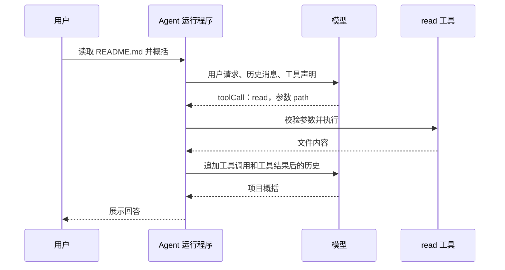
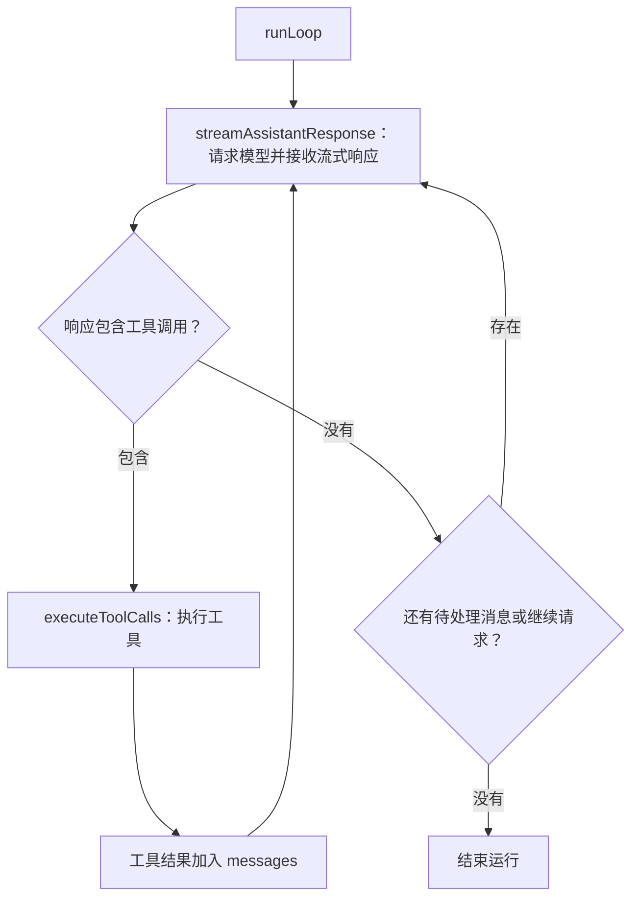

# Pi Coding Agent 源码学习路线

按照“最小示例 → Agent 循环 → 工具执行 → 上下文与会话 → 界面与扩展”的顺序学习。第一阶段的目标是：能追踪一次 `session.prompt()`，解释模型为什么会被调用多次，以及每次调用看到了哪些消息。

源码位置：`D:\ComputerScienceLearning\pi`。以下路径和函数名已按当前源码核对。

## 1. 理解一次任务怎样完成

例如用户说：“读取 README.md，概括这个项目。”



模型输出工具名称和参数，运行程序执行工具，并把结果送回模型。模型通过这些结果逐步获取代码、修改文件、检查修改是否正确。

## 2. 理解仓库的四个主要部分

| 包 | 负责什么 | 学习重点 |
| --- | --- | --- |
| `packages/ai` | 统一不同模型接口 | 请求构造、流式响应、工具调用解析 |
| `packages/agent` | 通用 Agent 运行循环 | 状态、消息、工具执行、继续和停止 |
| `packages/coding-agent` | 编程场景的完整应用 | 编程工具、项目上下文、会话、扩展 |
| `packages/tui` | 终端界面 | 输入、显示、刷新 |

先集中阅读前三个部分。当前仓库还有 `durable`、`chord`、`client/server` 等包，掌握主链路后再阅读。

## 3. 按顺序阅读源码

每一步带着一个具体问题阅读。

| 顺序 | 源码入口 | 阅读后应该能回答 |
| --- | --- | --- |
| 1 | [01-minimal.ts](../../pi/packages/coding-agent/examples/sdk/01-minimal.ts) | 如何创建会话、订阅事件、提交请求、查看消息历史？ |
| 2 | [agent/types.ts](../../pi/packages/agent/src/types.ts) | `AgentMessage`、`AgentState`、`AgentTool`、`AgentEvent` 分别表达什么？ |
| 3 | [agent-loop.ts](../../pi/packages/agent/src/agent-loop.ts) | 一轮模型响应之后，为什么继续，什么时候停止？ |
| 4 | [agent.ts](../../pi/packages/agent/src/agent.ts) | 消息历史怎样更新？如何取消、插入新指令、等待结束？ |
| 5 | [tools/read.ts](../../pi/packages/coding-agent/src/core/tools/read.ts) | 工具如何声明参数、读取文件、截断输出、返回结果？ |
| 6 | [sdk.ts](../../pi/packages/coding-agent/src/core/sdk.ts) → [agent-session.ts](../../pi/packages/coding-agent/src/core/agent-session.ts) | 模型、工具、配置、资源加载器和会话管理器如何组装？ |
| 7 | [model-runtime.ts](../../pi/packages/coding-agent/src/core/model-runtime.ts) → [openai-responses.ts](../../pi/packages/ai/src/api/openai-responses.ts) | 统一请求如何变成具体模型接口请求，再变回统一事件？ |
| 8 | [system-prompt.ts](../../pi/packages/coding-agent/src/core/system-prompt.ts) → [session-manager.ts](../../pi/packages/coding-agent/src/core/session-manager.ts) → [compaction.ts](../../pi/packages/coding-agent/src/core/compaction/compaction.ts) | 项目规则如何进入上下文？历史如何保存、恢复、压缩？ |

### 核心循环的阅读重点

第三步最重要。先阅读 `runLoop()`，然后跟踪它调用的 `streamAssistantResponse()` 和 `executeToolCalls()`。



这张图表示正常执行过程。错误响应、取消操作和主动结束也会影响停止条件，阅读时需要找到对应分支。

第一次阅读先理解单个工具的正常执行过程；第二次阅读关注错误、取消、并发和消息队列。

当前实现把系统提示词和工具声明记录在消息历史中。阅读时区分“程序实际能执行的工具”和“消息历史向模型声明的工具”。这有助于理解上下文构造、工具集合变化和会话恢复。

## 4. 使用现有测试进行单步调试

推荐从 [agent-loop.test.ts](../../pi/packages/agent/test/agent-loop.test.ts) 中的 `should handle tool calls and results` 测试开始。它使用模拟模型，预设两次模型响应：

1. 第一次模型调用要求执行 `echo("hello")`。
2. 工具执行返回 `echoed: hello`。
3. 第二次模型调用返回 `done`。

这个测试用于观察 Agent 循环和消息变化，无需调用真实模型接口。

在 PowerShell 中运行这个测试：

```powershell
cd D:\ComputerScienceLearning\pi\packages\agent
node ../../node_modules/vitest/dist/cli.js --run test/agent-loop.test.ts -t "should handle tool calls and results"
```

可以在 VS Code 的 JavaScript 调试终端中执行，并在以下位置设置断点：

- `runLoop()`：观察循环继续条件。
- `streamAssistantResponse()`：观察送给模型的 `llmMessages`。
- `prepareToolCall()`：观察工具查找和参数校验。
- `executePreparedToolCall()`：观察工具执行。
- 工具结果加入 `currentContext.messages` 的位置：比较下一次请求的历史。

每到一个断点，记录四件事：输入是什么、状态修改了什么、发出什么事件、接下来为什么执行这个分支。

## 5. 掌握主链路后完成三个练习

### 练习一：实现一个自定义工具

工具返回当前目录下的文件数量，参考 [06-extensions.ts](../../pi/packages/coding-agent/examples/sdk/06-extensions.ts)。掌握参数声明、工具注册、执行和结果返回。

### 练习二：观察工具失败后的执行过程

使用现有 [测试 harness](../../pi/packages/coding-agent/test/suite/harness.ts) 和 faux provider。faux provider 是可预设响应的模拟模型，用于确定性地观察运行程序的行为。

模拟一次工具失败，观察错误结果如何进入历史，以及下一轮如何继续。

### 练习三：比较保存的历史与模型收到的上下文

跟踪 `appendMessage()`、`buildSessionContext()` 和压缩流程，理解完整记录与当前请求上下文之间的关系。

之后学习 Skills、MCP、RPC 和终端界面，并说明每个机制解决的具体问题。

## 6. 第一份学习笔记的完成标准

第一份笔记可以只写一页，完成以下内容：

1. 画出一次请求的调用链。
2. 列出两次模型调用各自收到的消息。
3. 标出真正读取文件的代码。

能独立完成这一页，就已经掌握 Coding Agent 的核心运作方式。
